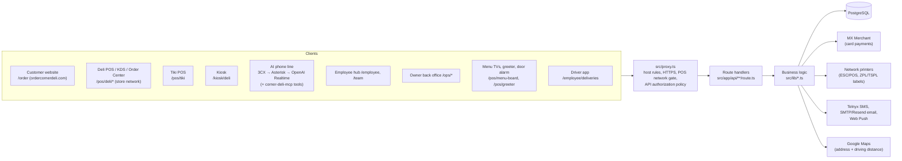
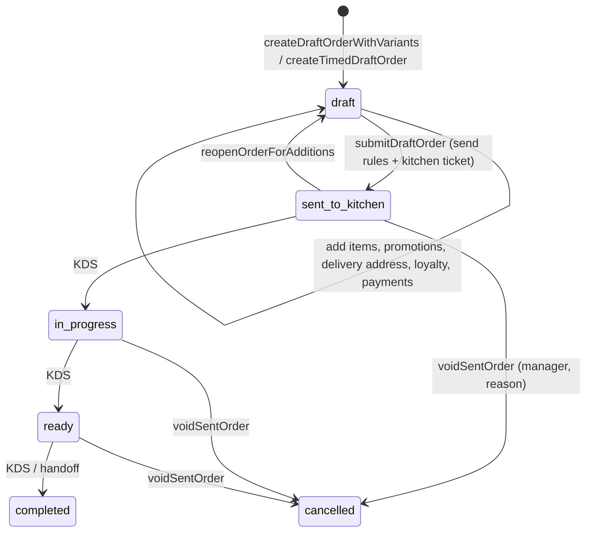

# Corner Ops architecture

The map of the software itself: what the pieces are, how a request moves through them, and where the rules
live. For machines, scheduled jobs, outside services and the weekly business processes, read
[PROCESS-MAP.md](PROCESS-MAP.md) first; this file does not repeat it. Online ordering has its own deep dive in
[online-ordering.md](online-ordering.md). Last full review: 2026-10-24 (see
[reviews/2026-10-24-production-review.md](reviews/2026-10-24-production-review.md)).

Contents: [Overview](#1-overview) · [Code layout](#2-code-layout) · [Request path and access](#3-request-path-and-access) ·
[Data](#4-data) · [Order engine](#5-order-engine) · [Payments](#6-payments) · [Kitchen, printing and alerts](#7-kitchen-printing-and-alerts) ·
[Store screens](#8-store-screens) · [Staff and back office](#9-staff-and-back-office) · [Background work](#10-background-work) ·
[Time and money rules](#11-time-and-money-rules) · [Testing](#12-testing) · [Known gaps](#13-known-gaps)

---

## 1. Overview

One Next.js 16 application (`src/`, App Router, Node runtime) backed by one PostgreSQL 17 database, run in
Docker on the store server. Every surface is a client of the same server-side order engine:

**Core rule** (from [pos-ordering-architecture.md](pos-ordering-architecture.md)): the server owns prices, taxes,
discounts, modifier rules, availability, delivery fees, minimums, loyalty and totals. Clients (including the AI)
only send choices; every price is recomputed from the database and re-checked when the order is sent.

Two businesses share the code: **Corner Deli** (POS, online ordering, delivery) and **Tiki / the Docks**
(seasonal bar: tabs, no drivers). Business-scoped data carries a `business` column; reporting is per business.

## 2. Code layout

| Path | What lives there |
|---|---|
| `src/proxy.ts` | Next.js middleware (named `proxy` in Next 16). Every request passes through it; see §3. |
| `src/app/**/page.tsx` | Pages. `/order` (customer), `/pos/*` (store network), `/ops/*` (owner), `/employee/*`, `/team`, `/track/[token]`, `/kiosk/deli`, games. |
| `src/app/api/**/route.ts` | ~210 route handlers. Thin: parse input, authorize, call `src/lib`, map errors to 4xx. |
| `src/lib/ordering-*.ts` | The order engine (≈100 files): menu, pricing, orders, lifecycle, payments, delivery, timing, loyalty, promotions, printing, reports. |
| `src/lib/mx-*.ts`, `payment-provider.ts` | MX Merchant (Dharma) checkout, refunds and terminal API. |
| `src/lib/customer-*.ts` | Customer sessions, sign-in (SMS code, email code, Google), order confirmation email. |
| `src/lib/*` (rest) | Workforce, scheduling, payroll, attendance, messaging, banking, accounting, documents, 3CX, greeter/menu-board, games. |
| `db/migrations/*.sql` | The only source of schema (§4). |
| `deploy/` | `update.sh` (dev auto-deploy), backups, systemd timers, staging scripts, supplier scraper, prod compose (`deploy/selfhost`). |
| `tools/` | Migration runner, door-chime detector, greeter Pi, menu-TV adb script, display app, 3CX CDR receiver. |
| `asterisk/` | Phone bridge container (3CX ↔ OpenAI Realtime). |
| `scripts/*-validate.ts` | Validation suites that run against the dev database inside a rolled-back transaction (§12). |
| `tests/` | `node --test` unit tests (`npm test`) and Playwright specs (`*.spec.ts`). |
| `android/`, `ios/`, `mobile-shell/`, `capacitor.config.ts` | Capacitor shells for the POS/driver apps. |

Code style notes for reviewers: many `src/lib` files are dense one-line-per-function code; read them with a
formatter. `ensure…Schema()` functions no longer create tables (CI enforces it); they only seed rows and fix
data, once per process.

## 3. Request path and access

`src/proxy.ts` runs in this order:

1. **Production host gate.** When `APP_ENV=production`, only hosts in `PRODUCTION_HOSTS` (ops/team domains,
   localhost) and on-box internal calls are served; anything else is a 404. **The public ordering hostnames are
   not in this list yet** (see [online-ordering.md §6](online-ordering.md#6-launch-checklist)).
2. **HTTPS.** Requests forwarded as plain http (Cloudflare `cf-visitor`, `x-forwarded-proto`) are redirected,
   except LAN addresses and the `192-168-x-x.nip.io` name the greeter TV uses.
3. **Removed vendors.** `/api/square`, `/api/rezku*` → 404.
4. **Security headers** on every response (HSTS, nosniff, frame-ancestors none, noindex) and the optional
   `ALLOWED_HOSTS` check (421).
5. **Team domains** (team.ordercornerdeli.com, team.atthedocks.com) serve only workforce routes
   (`src/lib/team-domain-routing.ts`).
6. **POS network gate.** `/pos/*`, `/api/pos/*` and the Deli POS APIs (`isDeliPosApi`) need a private-network
   client IP (`cf-connecting-ip` / `x-forwarded-for` / `x-real-ip`) or a signed `corner_ops_pos_network`
   cookie issued at `/pos/access`.
7. **API authorization.** For `/api/*`:
   - paths in `selfAuthorizedApiPaths` are passed through and **must authorize themselves** in the route
     (customer, cron, webhooks, POS, employee, driver, games…);
   - Deli POS APIs accept a signed `corner_ops_pos` cookie (employee PIN session, business "Corner Deli");
   - everything else needs the owner session cookie `corner_ops_session`; Owner/Co-Owner pass, other roles need
     the permission from `needed()`; an API with no policy is refused (403).

Sessions are HMAC-signed JSON cookies (`SESSION_SECRET`; purpose keys in `security-keys.ts`):

| Who | Cookie | Issued by | Checked in |
|---|---|---|---|
| Owner / managers (back office) | `corner_ops_session` | `/api/auth/session` | proxy + routes (`auth.ts`) |
| POS employee (PIN) | `corner_ops_pos` | `/api/pos/session` | proxy + `ordering-route-auth.ts` (`orderingActor`) |
| POS network pass | `corner_ops_pos_network` | `/api/pos/access` | proxy |
| Employee hub | employee session | `/api/employee/session` | `employee-auth.ts` |
| Customer (website) | `corner_customer_session` | `/api/customer/*` | `customer-ordering-session.ts` |
| Screens (KDS, labels, board) | screen pass | `screen-auth.ts`, `deli-board-auth.ts` | route |

Cron routes (`/api/cron/*`) require `CRON_SECRET`; internal routes (`/api/internal/*`) use
`internal-request.ts` plus their own secrets; Telnyx and 3CX webhooks verify their own signatures/secrets.

## 4. Data

- **One database per environment** (dev, staging, prod reference, production), PostgreSQL 17 in Docker, never
  published on 5432. Access from the app through `src/lib/db.ts`:
  - `getSql()` returns a tagged-template client over a `pg` pool (parameterized; no string-built SQL).
  - `withTransaction(fn)` runs `fn` on one pooled client inside BEGIN/COMMIT; nested calls **join** the outer
    transaction (no savepoints) through `AsyncLocalStorage`. `outsideTransaction(fn)` escapes it, used to record
    processor calls (MX refunds) that must survive a rollback. `inTransaction()` tells whether one is active.
  - The pool listens for idle-client errors, times out a connect after 10 s and lets Postgres end a
    transaction left idle for 5 minutes.
  - Postgres runs in UTC; timestamps come back as raw text in production (see `postgres-string-timestamps.ts`);
    dev-only APIs return ISO via `isoJson`.
- **Schema** comes only from `db/migrations/*.sql`, applied in order by `tools/db-migrate.sh` and recorded in
  `schema_migrations` with each file's git blob hash. A changed, already-applied file stops the run, so changes
  go in a new file. `0001*` is the production baseline; `0014_runtime_schema.sql` captured everything the old
  runtime `ensure…Schema()` code used to create. CI rejects runtime DDL (`verify_no_runtime_ddl.py`).
- **Main ordering tables:** `ordering_menu_*` (categories, items, variants, modifier groups/options, combos,
  pizza toppings, availability rules, channel overrides), `ordering_orders`, `ordering_order_items`
  (+ modifiers, combo selections, toppings), `ordering_order_events` (audit trail per version),
  `ordering_payment_transactions`, `ordering_mx_checkout_sessions`, `ordering_mx_reversal_attempts`,
  `ordering_checks` (split checks), `ordering_print_jobs`, `ordering_order_delivery_addresses`,
  `ordering_delivery_assignments`, `ordering_customers`, `ordering_customer_web_carts`, loyalty / gift card /
  store credit ledgers, `ordering_operating_windows` (+ special hours, closures), `ordering_register_sessions`.

## 5. Order engine

- **Creating and pricing** (`ordering-orders.ts`, `ordering-orders-with-variants.ts`, `ordering-timed-orders.ts`):
  `addConfiguredItem` reads item, variant, modifier, combo and topping prices from the database, enforces
  required/min/max/allowance rules and sold-out flags, and writes line snapshots. `recalculateOrder` and
  `applyPromotionsToOrder` keep order totals. Timing (ASAP vs future, quoted lead times) comes from
  `ordering-timing*.ts`; availability (operating windows, special hours, closures, overnight windows, cutoffs)
  from `ordering-availability.ts` and `ordering-hours-math.ts`.
- **Sending** (`submitDraftOrder` in `ordering-order-lifecycle.ts`) runs in one transaction with the order row
  locked: re-applies promotions, checks ordering hours (manager override with a reason), customer name/phone,
  delivery address, driving distance, delivery fee and minimum, then `revalidateDraft` re-prices every line and
  checks menu schedules. Only then does it move the order to `sent_to_kitchen`, finalize loyalty redemptions,
  earn loyalty, insert the kitchen print job and deplete inventory. A future order gets `kitchen_release_at` (prep
  time before it is due, except Halloween and Super Bowl Sunday); until then it isn't printed, listed on the KDS
  board or chimed, and `releaseHeldKitchenOrders` (ordering maintenance) releases it once. Web, kiosk and AI orders then push-notify the
  POS stations.
- **Preflight** (`preflightDraftSubmit`) runs the same rules and rolls back (a savepoint when nested). Online
  checkout calls it before charging the card.
- **Reopen / additions**: a sent order can be reopened for additions; the next send prints only the added items
  ("ADD ON") plus void/service-change lines. `restoreAbandonedReopenedOrders` puts back abandoned reopens.
- **Pickup / delivery switch**: tapping the type on a reopened order saves at once (`ordering-fulfillment-change.ts`). Delivery uses the order's address, else the customer's most used saved address, else asks; the fee is added or removed then. Send tells the kitchen. A paid fee that comes off shows under "Needs refund or credit". Refused while a driver has the order.
- **Part of a cash order** goes back as store credit, not till cash (`ordering-refund-policy.ts`, enforced in item voids and "Needs refund or credit"). A whole order still refunds in cash, and so does part of an order with no customer on it.
- **Daily report** (`ordering-manager-report.ts`): tills, voids, refunds, credits, missed calls and sales by business day, week (Monday start) or month. `/employee/manager` in the employee hub (anywhere) and `/pos/deli/manager` (store), both manager/owner only.
- **Voids** (`ordering-voids.ts`): manager + reason; reverses loyalty and reconciles tips. **It does not refund
  payments** (recorded as `paymentWasNotRefunded`); refunds are separate tender reversals.
- **Item cancellations** (`ordering-item-cancellations.ts`): cancel part of a line after send, with refund or
  courtesy credit.
- **Tender reversals** (`reverseTender` in `ordering-payments.ts`): manager only; MX card refunds/voids first
  (logged outside the transaction), then gift card, store credit or cash-drawer bookkeeping.

## 6. Payments

| Tender | Where | Notes |
|---|---|---|
| Card, online | `/api/customer/orders/[id]/payments/mx` + `mx-keyed-payment-dialog.tsx` | MX Checkout API: server issues a token, the browser charges MX directly with a `replayId`, the server confirms by looking the payment up at MX. See [online-ordering.md §4](online-ordering.md#4-card-payment). |
| Card, keyed at POS | `/api/ordering/orders/[id]/payments/mx` | Same Checkout API, POS dialog. |
| Card, terminal | `mx-terminal-payments.ts` | Terminal API: authorize, tip, capture (`completeWithTip`); auto-capture sweep in ordering maintenance. **Waiting on a terminal assignment from MX.** |
| Cash | `commitTender` | Must land in an open register session when payment stations exist. |
| Gift card, store credit, loyalty | ledgers (`ordering-gift-cards.ts`, `ordering-store-credit.ts`, `ordering-loyalty*.ts`) | Ledger rows are the balance; advisory locks per customer for store credit. |

`commitTender` is idempotent per `(business, client_mutation_id)`, locks the order (and check) row, refuses
voided orders, and refuses card tenders without a provider approval or above the balance. `MX_ENVIRONMENT`
selects production vs sandbox (**unset means sandbox**).

## 7. Kitchen, printing and alerts

- `ordering_print_jobs` holds every ticket/receipt/label job. Jobs are claimed atomically (no double print),
  retried with backoff up to 4 attempts within an hour (`retryDuePrintJobs`), and can be paused (auto-print
  pause). Kitchen tickets for voided orders are not retried.
- Printers are network ESC/POS (`printer-network.ts`, `ordering-print-format.ts`, `kitchen-ticket-layout.ts`);
  labels are ZPL/TSPL (`ordering-label-print.ts`).
- The kitchen display (`/pos/deli/kitchen`) polls `/api/ordering/kitchen`; that poll also runs ordering
  maintenance at most every 20 s (print retries, abandoned reopens, terminal auto-capture).
- **Online-order alert:** every POS device polls `/api/ordering/orders/online-alerts` every 3 s and chimes
  (repeating every 20 s) until acknowledged; it lists web/kiosk/AI orders in `sent_to_kitchen` plus web orders
  that were **paid but not sent** (a send rule failed after the charge). Web Push notifies installed devices too.

## 8. Store screens

Menu TVs (`/pos/menu-board`, `src/lib/menu-board*.ts`), the greeter (`/pos/greeter`, `/pos/greeter/tv`), the door
alarm and the status board are described in PROCESS-MAP §8a/§8b. They run against the **dev** app on :3000 and
read prices and sold-out flags straight from the POS menu, so a dev deploy restarts what the store's TVs show
(they reload on error). The camera walk-in feed only measures; it never touches the POS.

## 9. Staff and back office

- **Workforce:** employees, positions, schedules (draft/publish, SMS/email delivery), time off, time clock
  (`/clock`, POS clock-in), attendance and missed clock-outs, payroll summary/approval and the Payroll Relief
  upload (PROCESS-MAP §4–5), employment forms (encrypted with `EMPLOYMENT_FORMS_ENCRYPTION_KEY`), handbook,
  direct deposit, messaging (owner ↔ employee conversations, push).
- **Money:** banking (Plaid), card statements, accounting control, expense control, finance operations,
  invoice OCR, supplier prices.
- **Calls:** 3CX CDR import, missed-call alerts, AI phone line (OpenAI Realtime via Asterisk, ordering tools in
  `corner-deli-mcp`).

## 10. Background work

All scheduled work is an HTTP call into the app (`deploy/run-cron.sh` → `/api/cron/*` with `CRON_SECRET`),
from systemd timers on dev and chris's crontab on production (PROCESS-MAP §3). Work that matters for orders:

| Job | Route | Does |
|---|---|---|
| Ordering maintenance | `/api/cron/ordering-maintenance` (dev: every minute; **production: not scheduled yet**) | print retries, abandoned reopens, terminal auto-capture |
| Scheduler | `/api/cron/scheduler-0700` / `-0800` | runs once at 3 AM Eastern: payroll capture, weather, missed shifts, overtime, bank sync, expenses |
| Schedule delivery | `/api/cron/schedule-delivery` | schedule texts/emails |
| Missed clock-outs | `/api/cron/missed-clock-outs` | 15-minute check, Monday payroll 8 AM / 5 PM |

Confirmation emails are sent with `after()` (after the response) with an idempotency key; failures are recorded,
never block the order.

## 11. Time and money rules

- **Store time zone** is America/New_York everywhere a date is shown or grouped. The **business day** starts at
  4 AM Eastern (`src/lib/business-day.ts`); reports, payroll weeks (Monday 4 AM) and dashboards use it. Postgres
  is UTC, so SQL that means "today" must say `date_trunc('day', NOW() AT TIME ZONE 'America/New_York') AT TIME ZONE 'America/New_York'`,
  never `CURRENT_DATE`.
- **Prices include sales tax.** `tax_cents` on orders stays 0; tax is backed out for reports
  (`ordering-sales-tax.ts`, `round(gross × r / (1 + r))` with the rate history). Never add tax on top.
- Money is integer cents. Percent discounts round once and the remainder goes to the last line; half-pizza
  toppings round up.

## 12. Testing

| Command | What | Touches |
|---|---|---|
| `npx tsc --noEmit` | type check | nothing |
| `npm test` | `node --test` unit tests (`tests/*.test.ts`, files listed in `tsconfig.tests.json`) | nothing (db mocked) |
| `npm run test:<area>` | `scripts/*-validate.ts` suites (ordering lifecycle, payments, availability, promotions, delivery, voids, online checkout preflight, …) | **dev database**, inside a transaction that is rolled back |
| `npm run test:*:e2e` | Playwright specs against `POS_BASE_URL` (default dev :3000) | dev app |

CI (`.github/workflows/verify.yml`, `schema-verify.yml`) runs on the deli's own runner (liberty-ci-01) for
pushes/PRs to `main`; see the review for its current state.

## 13. Known gaps

The open list with owners and decisions is in
[reviews/2026-10-24-production-review.md](reviews/2026-10-24-production-review.md). The ones that shape the
architecture:

- Production can't serve the public ordering hostnames yet (host gate, tunnel ingress, env vars).
- Voids don't refund; refunds are a separate manager step.
- Ordering maintenance isn't scheduled in production.
- Backups stay on the store server's disk.
