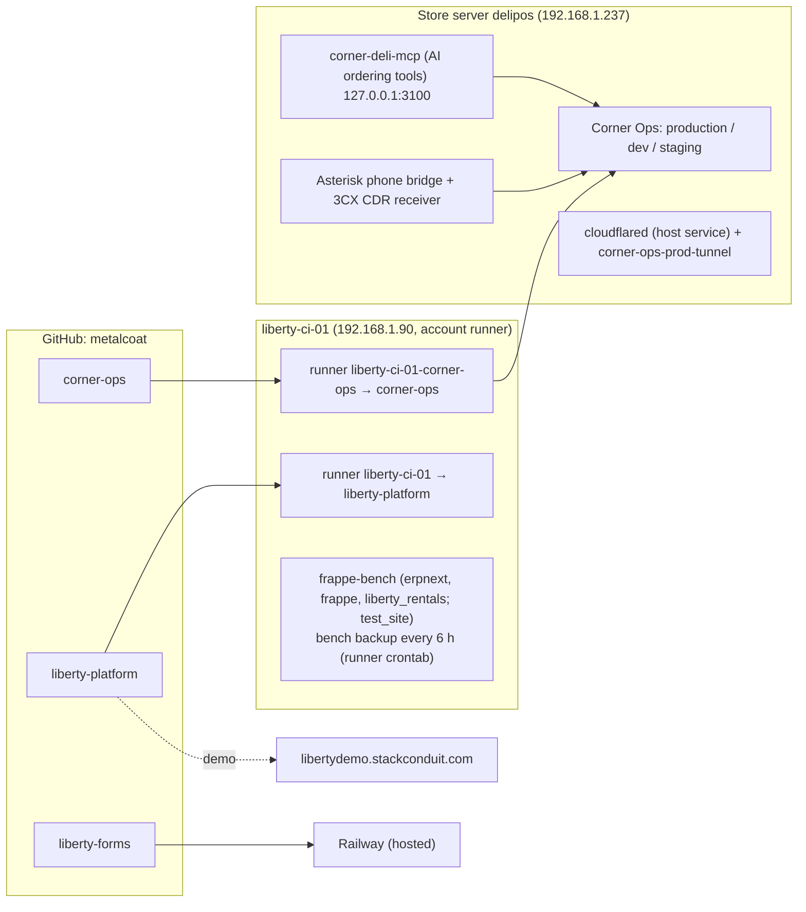
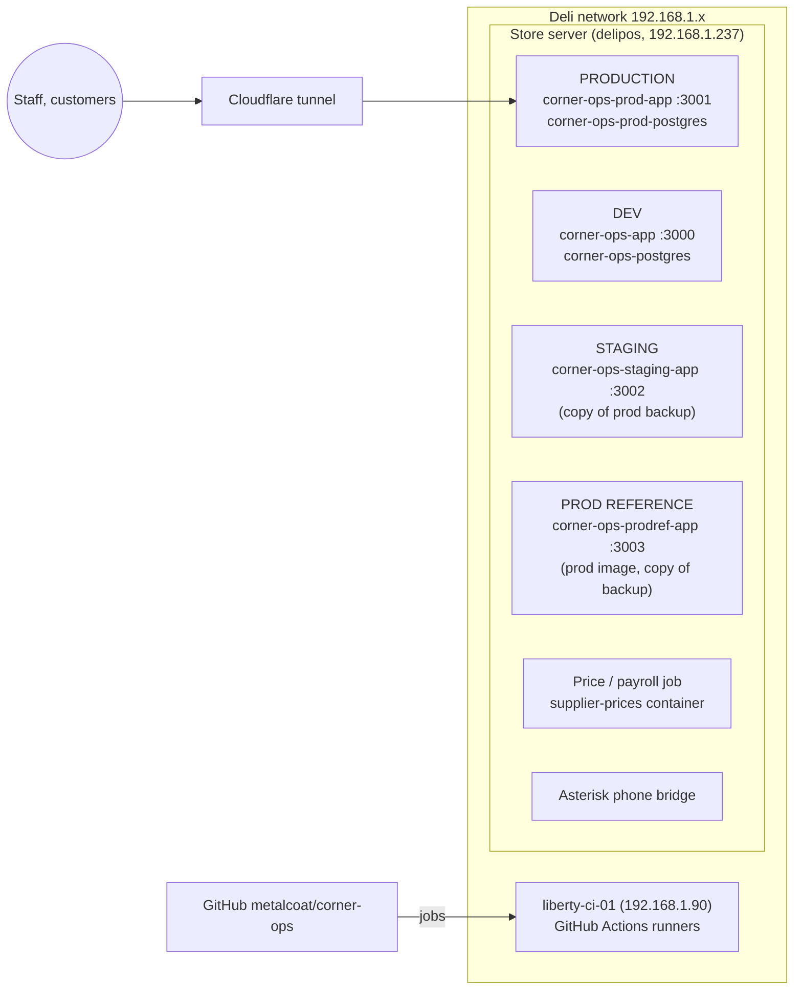
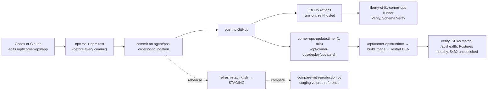
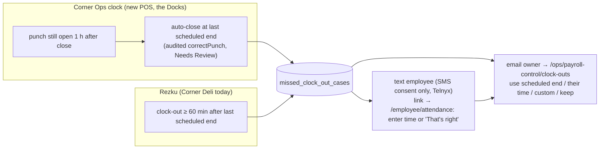
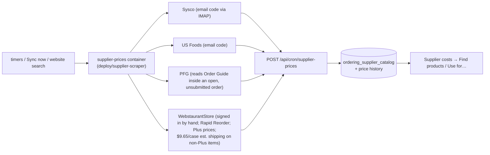
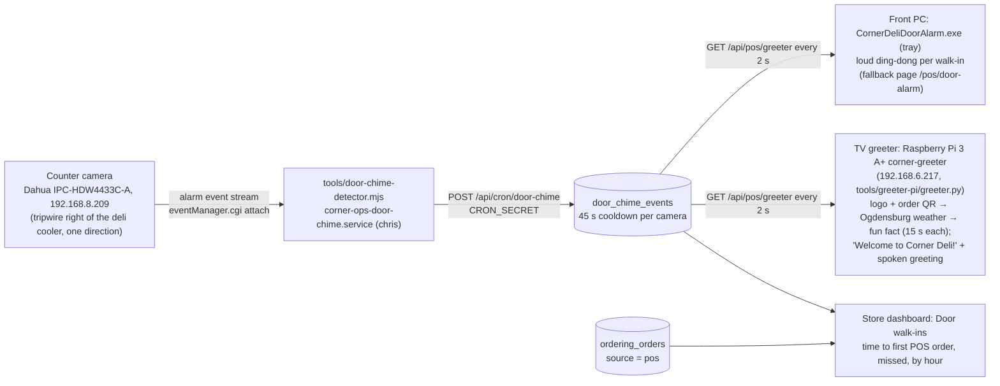

# Corner Ops process map

How code, servers, scheduled jobs, outside services and the weekly business
processes connect. Shared by every assistant (Codex and Claude) and by people.
**Keep it current:** when you change a flow below, update this file in the same
commit. Last full review: 2026-10-12.

Contents: [All programs](#0-all-programs) · [Machines](#1-machines-and-environments) ·
[Code to running app](#2-code-to-running-app) ·
[Scheduled jobs](#3-scheduled-jobs) ·
[Weekly payroll](#4-weekly-payroll-corner-deli) ·
[Clock-outs](#5-forgotten-clock-outs) ·
[Supplier prices](#6-supplier-prices) ·
[Sign-ins by hand](#7-sign-ins-done-by-a-person) ·
[Outside services](#8-outside-services) ·
[Walk-ins](#8a-entrance-walk-ins-corner-deli) ·
[Guardrails](#9-guardrails-for-assistants) ·
[Open items](#10-open-items-before-the-switch)

---

## 0. All programs



| Program | Repo | Runs on | CI runs on | Notes |
|---|---|---|---|---|
| Corner Ops (Corner Deli + the Docks) | `corner-ops` | store server | liberty-ci-01 (`liberty-ci-01-corner-ops`) | everything below this section |
| AI ordering tools (MCP) | image `corner-deli-mcp:local` | store server, 127.0.0.1:3100 | — | used by the AI phone/ordering line (`OPENAI_ORDERING_MCP_*`) |
| Phone bridge | `corner-ops/asterisk`, `tools/3cx-cdr-receiver.mjs` | store server | with Corner Ops | 3CX ↔ Asterisk ↔ app |
| Liberty Platform (rental operations; SAP B1/Fame replacement) | `liberty-platform` | demo: libertydemo.stackconduit.com; Frappe POC on liberty-ci-01 | liberty-ci-01 | see that repo's README / docs/IMPLEMENTATION.md |
| Liberty Forms (HVAC rental agreements, quotes, signing) | `liberty-forms` | Railway | liberty-ci-01 | SendGrid email; `LIBERTY_MODE=live` for customer use |

Owner direction (2026-10-12): **builds and checks for all programs run on the local runner**
(GitHub Actions orchestrates; jobs run on liberty-ci-01, never GitHub-hosted runners). liberty-ci-01
hosts one runner per repo (a personal account can't share a runner across repos), each a user systemd
service under account `runner` (linger on, no sudo):

| Repo | Runner | Service | Postgres test port on the host |
|---|---|---|---|
| liberty-platform | `liberty-ci-01` | `actions.runner.metalcoat-liberty-platform.liberty-ci-01` (system) | 15432 |
| liberty-forms | `liberty-ci-01-liberty-forms` | `actions-runner-liberty-forms` (user) | 25432 |
| corner-ops | `liberty-ci-01-corner-ops` | `actions-runner-corner-ops` (user) | 35432 |

Jobs share the host, so each repo's workflow publishes its Postgres service on its own port. Browser
system libraries for Playwright must be installed on liberty-ci-01 once by an admin
(`sudo npx playwright install-deps chromium webkit`); workflows skip `--with-deps`/sudo when
`RUNNER_ENVIRONMENT=self-hosted`. New workflows: `runs-on: [self-hosted]` and a free host port.

## 1. Machines and environments



| | Production (current) | Dev | Staging | Prod reference |
|---|---|---|---|---|
| Who uses it | Staff and customers | Development | Rehearsing the switch | Side-by-side checks |
| Address | ops/team.ordercornerdeli.com, team.atthedocks.com (Cloudflare) | 192.168.1.237:3000 | 192.168.1.237:3002 (deli network only) | 192.168.1.237:3003 (deli network only) |
| Code | `/opt/corner-ops/production/release` — a copied folder, **not git**, ≈ `main` + hand edits | `/opt/corner-ops/runtime` = branch `agent/pos-ordering-foundation` | a commit of this repo, `/opt/corner-ops/staging/app` | the image production runs |
| Data | live | dev test data | last nightly prod backup | last nightly prod backup |
| Settings | `/opt/corner-ops/production/.env` | `/opt/corner-ops/.env` | `/opt/corner-ops/staging/.env` (outbound texts/email/push/providers removed, MX sandbox) | same as staging |
| Jobs | chris's crontab | systemd timers | none | none |
| Build / refresh | by hand (compose in `release/deploy/selfhost`) | `deploy/update.sh` (timer, every minute) | `deploy/staging/refresh-staging.sh` | `deploy/staging/start-production-reference.sh` |

Production is the only place with real staff/customer activity. Messaging and
payroll history in production must survive the switch; Rezku and Square are being retired.

## 2. Code to running app



- Milestone steps are in `AGENTS.md` (commit → push → `update.sh --force` as chris → verify).
- **GitHub Actions only orchestrates; jobs run on the deli's own runner.** liberty-ci-01
  hosts two runners: `liberty-ci-01` (repo `metalcoat/liberty-platform`) and
  `liberty-ci-01-corner-ops` (this repo; labels `self-hosted, Linux, X64, liberty-ci, corner-ops`),
  a user systemd service `actions-runner-corner-ops` under account `runner` (linger on; no sudo).
  The store server reaches it as `ssh liberty-ci-01` (key `~/.ssh/liberty_ci_ed25519`).
  Workflows must use `runs-on: [self-hosted]`; never GitHub-hosted runners.
- Vercel and Neon are retired (project paused, Neon removed). Nothing should deploy there.
- After builds, dangling Docker images older than a day are pruned (the disk filled once).

## 3. Scheduled jobs

| Job | Production (crontab → :3001) | Dev (systemd timer → :3000) |
|---|---|---|
| Nightly backup | 02:20 `backup_prod.sh` → `production/backups` | `corner-ops-backup.timer` |
| Scheduler (payroll capture, weather, missed shifts, overtime, bank sync, expenses) | 07:00 and 08:00 UTC | `corner-ops-cron-scheduler.timer` |
| Schedule delivery (schedule texts/emails) | every 5 min | `corner-ops-cron-schedule-delivery.timer` |
| Rezku repair | every 15 min (**remove at switch**) | — |
| Ordering maintenance | — | `corner-ops-cron-maintenance.timer` |
| Interim Monday payroll email (until the switch) | 12:00 + 13:00 UTC Mondays → acts at 8 AM Eastern: `deploy/staging/monday-payroll-preview.sh` (fresh backup → staging → puts back the saved Payroll Relief employee list + matches, `staging/payroll-relief-{roster,matches}.json` → email owner; approve on staging) | — |
| Missed clock-outs + Monday payroll (8 AM / 5 PM) | **not yet** | `deploy/systemd/corner-ops-cron-missed-clock-outs.timer` (every 15 min; install with `install-timers.sh`) |
| Supplier price files + Sync now + website searches + payroll sends | — | `corner-ops-supplier-prices.timer` (every 5 min) |
| Supplier website prices | — | `corner-ops-supplier-website.timer` (twice daily) |

## 4. Weekly payroll (Corner Deli)

The Docks (Tiki) is a separate, seasonal company: summary only, never sent automatically.

```mermaid
flowchart TD
  rz["Rezku daily labor report email<br/>(Sunday's often arrives Monday morning)"] --> rs[(rezku_shifts)]
  pos["New POS clock (after the switch)"] --> te[(time_entries)]
  rs --> sum["payrollSummary (payroll-summary-rules.ts)<br/>regular · tipped (driver) hours · tips · OT"]
  te -. "after switch: Corner Deli hours<br/>must come from here (open item)" .-> sum
  sched[(schedule_shifts)] --> cmpw["Scheduled vs worked<br/>(payroll-schedule-compare.ts)"]
  sum --> d["Monday: draft for last week"]
  cmpw --> d
  d --> e8["08:00 Mon email to PAYROLL_NOTIFY_EMAIL<br/>hours, tips, what's off, blockers<br/>(waits for Sunday until 12:00)"]
  e8 --> win{"Before 17:00:<br/>fixes / Hold?"}
  win -->|Hold or blocked| ns["'Not sent at 5 PM' email<br/>owner approves on /ops/payroll-control"]
  win -->|clear| a5["17:00 recalculate → approve & lock<br/>'Automatic 5 PM approval'"]
  ns --> a5m["manual Approve & lock"]
  a5 --> q[(payroll_submissions)]
  a5m --> q
  q --> pr["payroll-relief.mjs on the store server<br/>sign in (texted code → code box on payroll page)<br/>check period · download Excel timesheet · fill · upload<br/>check totals · Save"]
  pr --> sub{"PAYROLL_RELIEF_AUTO_SUBMIT=1<br/>and submit_after_save?"}
  sub -->|no (default)| saved["status 'submitted' = saved<br/>owner presses Submit in Payroll Relief"]
  sub -->|yes| send["press 'Submit' once → verify<br/>status 'sent' → Whalen, Davey & Looney"]
```

- Payroll website: AccountantsOffice → **Payroll Relief** (IRIS), employer *Mike's Corner Deli, LLC*,
  submission method *Excel Timesheet*. Columns filled: Reg, TipWa (tipped/driver hours),
  PCTip (tips incl. manual), OT. Salaried rows, Sick, SPOH, Overpay are never touched.
- Employee matching (Corner Ops payroll name → Payroll Relief EE #) is on the payroll page.
- Dry run (fills the file, uploads nothing): `supplier-prices-sync.sh --payroll-dry-run <weekStart>`.
- Payroll Relief behaviour (seen on the real site, 2026-10-12, week 10/5–10/11):
  - "Download Excel" is `GET https://app.payrollrelief.com/Payroll/CreateCsv?sendEmail=false` (sendEmail=true emails it — never use).
    The job fetches it directly; Chromium's download handling crashed in the container.
  - **Uploading the Excel timesheet stores the entries immediately**; Save stays greyed out. The job verifies by
    re-downloading the stored timesheet and comparing totals; it never re-runs after an upload.
  - After the owner pressed Submit, the current payroll moved to the next week (#44) and the submitted one appeared
    under Approved as "10/16/2026 - 43 - Normal" (pay date - number - type). The job's Submit check relies on this.
  - Nightly backups (02:20 UTC = 10:20 PM Eastern) run before Rezku's 11:01 PM Eastern labour report, so each
    backup misses that day's hours; the interim Monday email takes its own fresh backup.
  - The AccountantsOffice session lasts a few hours; most Mondays need the texted code (code box on the payroll page).
    Since 2026-10-19 it first asks "Select verification method" (text / call); the job picks the text message.
  - Chromium leaves `Singleton*` lock files after a crash; jobs clear them before launching (one job at a time).
- Automatic Submit stays **off** until a first Submit has been watched together.

## 5. Forgotten clock-outs



- Rezku always closes shifts (no NULL clock-outs in history), so "late clock-out vs schedule" is the Rezku signal.
- Production hook still to add: after a Rezku shifts import in production's `safe-rezku-import.ts`, call
  `runMissedClockOutCheck({ sources: ["rezku"], rezkuBatchId })`.

## 6. Supplier prices



- "Search supplier websites" queues a term (`ordering_supplier_site_searches`); the job searches each site's own search.
- Prices reach stock items only once linked ("Use for…"). Dev has no stock items yet (open item).

## 7. Sign-ins done by a person

Some sites need a human (robot check or texted code). `supplier-prices-sync.sh --signin <site>`
opens the job's own browser on a virtual screen as a web page **on the deli network only**
(`http://192.168.1.237:6080/vnc.html…`, one-time password, 15 minutes). The saved session
(profile in Docker volume `corner-ops_cornerops_supplier_browsers`, plus session cookies) is reused.

| Site | Why | How long it lasts |
|---|---|---|
| WebstaurantStore | reCAPTCHA | long |
| AccountantsOffice | code texted to the owner | ~hours; Monday sends ask for the code on the payroll page |

Never automate around robot checks.

## 8. Outside services

| Service | Used for | Where configured |
|---|---|---|
| MX Merchant (Dharma) | card payments, terminal (Terminal API + Checkout API) | `MX_*` in .env (dev: sandbox) |
| Telnyx | texts to staff/customers (consent required) | `TELNYX_*` |
| SMTP / Resend | email (Resend account came through Vercel; keep it) | `SMTP_*`, `RESEND_*` |
| Web push | app notifications (subscriptions record their web address) | `PUSH_VAPID_*` |
| Plaid | bank feeds | `PLAID_*` |
| 3CX / Asterisk | phones, missed-call alerts, AI ordering line | `THREE_CX_*`, asterisk service |
| Cloudflare tunnel | public access to production | `corner-ops-prod-tunnel` (do not modify) |
| Sysco, US Foods, PFG, WebstaurantStore | supplier prices | `*_USERNAME/_PASSWORD` |
| AccountantsOffice / Payroll Relief | payroll entry | `ACCOUNTANTSOFFICE_*`, `PAYROLL_RELIEF_AUTO_SUBMIT` |
| GitHub + liberty-ci-01 | source control, CI | runner service on liberty-ci-01 |

## 8a. Entrance walk-ins (Corner Deli)



- Nothing shows on the POS screens; this only measures. Each POS order started is matched to the oldest walk-in still
  waiting (first come, first served). No order within 10 minutes = missed. Online, kiosk and AI-phone orders don't count.
- The front door (logo door) is at the back of the camera view, behind the deli cooler; people crossing the line by
  the cooler toward the customer side count as walk-ins. Staff crossing it count too.
- Camera rules now: two one-way tripwires, DoorIn (at the logo door) and DoorIn2 (under the front window, past the
  deli cooler); a person crossing both counts once (45 s cooldown). The listener reconnects every 5 minutes because
  the camera can leave an open alert connection silent after its rules are edited.
- Camera login lives in `/opt/corner-ops/config/door-camera.env` (never committed); see the detector's header for settings.
  `--probe` shows the device and its detection rules. Camera settings backup: `/opt/corner-ops/config/door-camera-backup-*.txt`.
- TV greeter: the Pi (user chris, SSH key `~/.ssh/corner_greeter_ed25519` on the store server) runs
  `tools/greeter-pi/greeter.py` from labwc autostart (Chromium is too heavy for its 512 MB). It shows
  `public/greeter/idle.png` / `welcome.png` (rendered from `/pos/greeter`) and plays `welcome.mp3` to HDMI.
  The QR points at `GREETER_ORDER_URL` (default https://ordercornerdeli.com).
- TV fun facts: `src/lib/greeter-facts.ts` (edit freely; keep them short and true). `GET /api/pos/greeter/facts`
  gives the count and a version; the Pi downloads `GET /api/pos/greeter/fact?n=` pictures again when the version
  changes (checked at start and every 6 hours).
- TV weather slide: `GET /api/pos/greeter/weather` draws a PNG from api.weather.gov (forecast for the Ogdensburg
  gridpoint, current reading from KOGS, else KMSS), cached 20 minutes; keeps the last good forecast if weather.gov
  is down. Requests identify as `CornerDeli-TV/1.0 (ordercornerdeli.com)`.
  The picture leaves the sky beside the temperature and a corner of each day card plain; the Pi animates the weather
  there (sun, moon and stars, clouds, rain, snow, lightning, fog), placed by `GET /api/pos/greeter/weather/info`
  (`src/lib/greeter-weather-layout.ts`). Only those areas are redrawn, about 12 times a second.
- Front PC door alarm: `tools/door-alarm-windows` (Go tray program, download
  `/downloads/CornerDeliDoorAlarm.zip`), started from the PC's shell:startup folder.
- `/api/pos/greeter` is read-only and unauthenticated but store-network only; it returns just the newest
  walk-in's id, kind and age.
- Camera clock: GMT-4 with time server sync and its own DST rule off (the firmware ignores it); set GMT-5 on the
  first Sunday of November and GMT-4 on the second Sunday of March.
- Dev only so far (port 3000). The service is not installed until the camera line is in place.

## 9. Guardrails for assistants

- Follow `AGENTS.md`: no merging `main`, no production deploys or production data changes without the owner's
  explicit go-ahead for that exact action; never publish Postgres 5432; never commit secrets.
- Production changes are rehearsed on staging (+ prod reference comparison) first.
- Staging must never send texts/emails/pushes or reach providers — keep using `make-staging-env.py`.
- Payroll: never press Submit unless `PAYROLL_RELIEF_AUTO_SUBMIT=1` and the owner has approved that.
- Run test sends against staging or with mocks; dev .env holds real credentials.
- Timestamps from Postgres come back as raw text (production behaviour); dev-only APIs return ISO via `isoJson`.

## 10. Open items before the switch

1. **Corner Deli payroll from the POS clock and POS tips** (today it reads only Rezku tables).
2. **Runtime vs migration schema:** `main`'s Verify rejects runtime `CREATE/ALTER TABLE`; dev relies on it.
   Decide and write migrations for production. (Verify fails on the runner until then.)
3. Rezku missed clock-out hook in production (see §5).
4. Production crontab at switch: add missed-clock-outs every 15 min, remove rezku-repair; set `APP_ENV=production`,
   `PAYROLL_NOTIFY_EMAIL`; staff sign in once (new session format).
5. Missed-call alerts read `rezku_shifts` to know who is on shift — move to the new clock.
6. Staff re-enable notifications on team.ordercornerdeli.com (old Vercel installs).
7. Rezku menu capture workflow fails on the runner (needs sudo for browser deps); retire with Rezku.
8. MX: questions to MX support (terminal model, fees, receipts, PIN debit tips) before ordering hardware.
