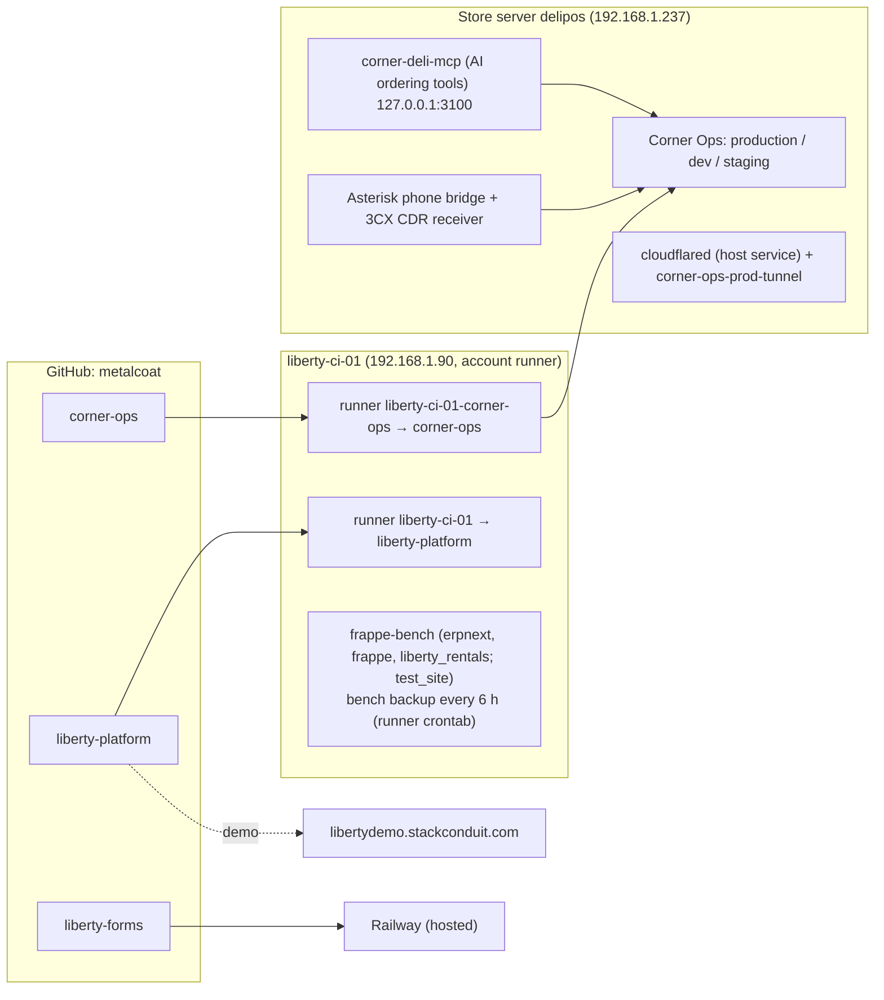
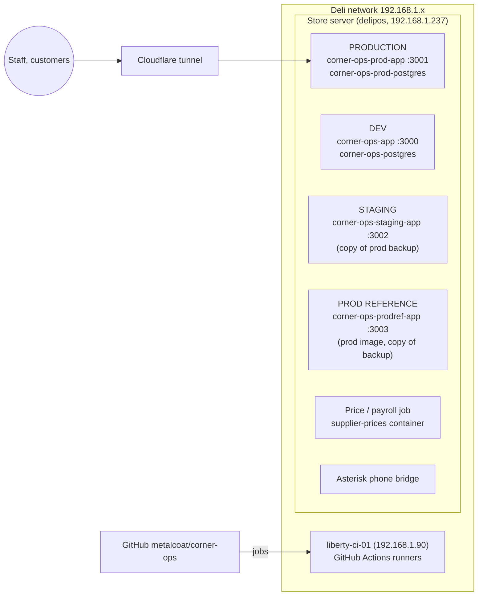
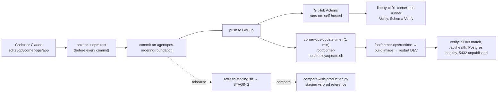
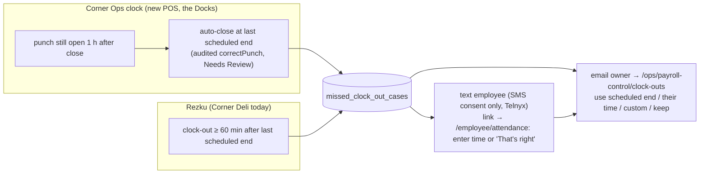
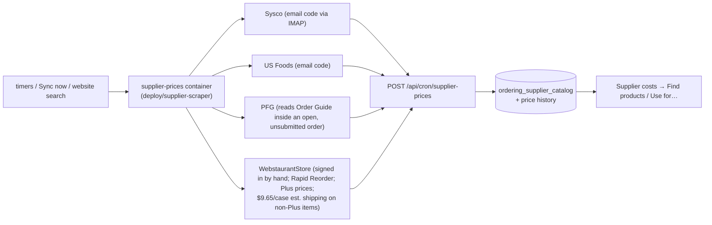
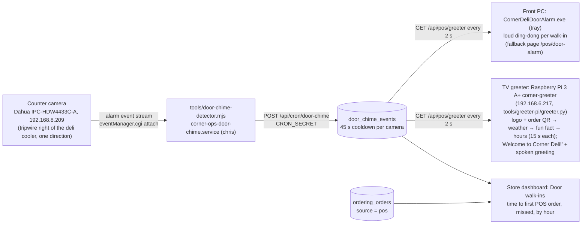
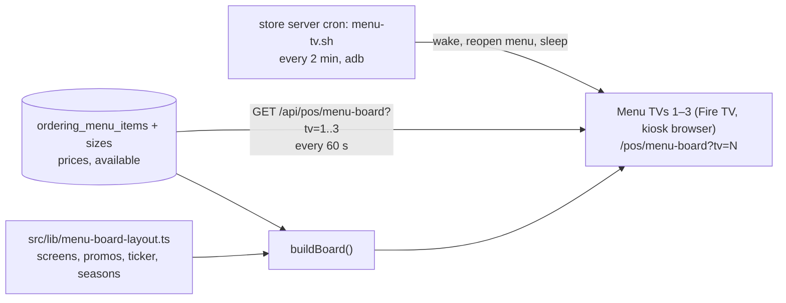
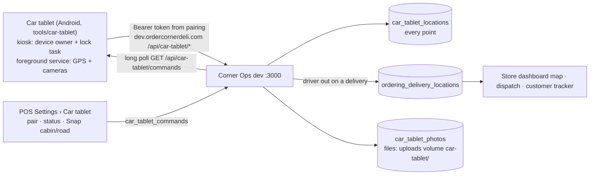

# Corner Ops process map

How code, servers, scheduled jobs, outside services and the weekly business
processes connect. Shared by every assistant (Codex and Claude) and by people.
**Keep it current:** when you change a flow below, update this file in the same
commit. Last full review: 2026-10-12. The software itself (request path, order engine, payments, printing) is in
[ARCHITECTURE.md](ARCHITECTURE.md); online ordering in [online-ordering.md](online-ordering.md); the 2026-10-24
production review in [reviews/2026-10-24-production-review.md](reviews/2026-10-24-production-review.md).

Contents: [All programs](#0-all-programs) · [Machines](#1-machines-and-environments) ·
[Code to running app](#2-code-to-running-app) ·
[Scheduled jobs](#3-scheduled-jobs) ·
[Weekly payroll](#4-weekly-payroll-corner-deli) ·
[Clock-outs](#5-forgotten-clock-outs) ·
[Supplier prices](#6-supplier-prices) ·
[Sign-ins by hand](#7-sign-ins-done-by-a-person) ·
[Outside services](#8-outside-services) ·
[Walk-ins](#8a-entrance-walk-ins-corner-deli) ·
[Car tablet](#8c-delivery-car-tablet-corner-deli-dev) ·
[Guardrails](#9-guardrails-for-assistants) ·
[Open items](#10-open-items-before-the-switch)

---

## 0. All programs



| Program | Repo | Runs on | CI runs on | Notes |
|---|---|---|---|---|
| Corner Ops (Corner Deli + the Docks) | `corner-ops` | store server | liberty-ci-01 (`liberty-ci-01-corner-ops`) | everything below this section |
| AI ordering tools (MCP) | image `corner-deli-mcp:local` | store server, 127.0.0.1:3100 | — | used by the AI phone/ordering line (`OPENAI_ORDERING_MCP_*`) |
| Phone bridge | `corner-ops/asterisk`, `tools/3cx-cdr-receiver.mjs` | store server | with Corner Ops | 3CX ↔ Asterisk ↔ app |
| Liberty Platform (rental operations; SAP B1/Fame replacement) | `liberty-platform` | demo: libertydemo.stackconduit.com; Frappe POC on liberty-ci-01 | liberty-ci-01 | see that repo's README / docs/IMPLEMENTATION.md |
| Liberty Forms (HVAC rental agreements, quotes, signing) | `liberty-forms` | Railway | liberty-ci-01 | SendGrid email; `LIBERTY_MODE=live` for customer use |

Owner direction (2026-10-12): **builds and checks for all programs run on the local runner**
(GitHub Actions orchestrates; jobs run on liberty-ci-01, never GitHub-hosted runners). liberty-ci-01
hosts one runner per repo (a personal account can't share a runner across repos), each a user systemd
service under account `runner` (linger on, no sudo):

| Repo | Runner | Service | Postgres test port on the host |
|---|---|---|---|
| liberty-platform | `liberty-ci-01` | `actions.runner.metalcoat-liberty-platform.liberty-ci-01` (system) | 15432 |
| liberty-forms | `liberty-ci-01-liberty-forms` | `actions-runner-liberty-forms` (user) | 25432 |
| corner-ops | `liberty-ci-01-corner-ops` | `actions-runner-corner-ops` (user) | 35432 |

Jobs share the host, so each repo's workflow publishes its Postgres service on its own port. Browser
system libraries for Playwright must be installed on liberty-ci-01 once by an admin
(`sudo npx playwright install-deps chromium webkit`); workflows skip `--with-deps`/sudo when
`RUNNER_ENVIRONMENT=self-hosted`. New workflows: `runs-on: [self-hosted]` and a free host port.

## 1. Machines and environments



| | Production (current) | Dev | Staging | Prod reference |
|---|---|---|---|---|
| Who uses it | Staff and customers | Development | Rehearsing the switch | Side-by-side checks |
| Address | ops/team.ordercornerdeli.com, team.atthedocks.com (Cloudflare) | 192.168.1.237:3000 | 192.168.1.237:3002 (deli network only) | 192.168.1.237:3003 (deli network only) |
| Code | `/opt/corner-ops/production/release` — a copied folder, **not git**, ≈ `main` + hand edits | `/opt/corner-ops/runtime` = branch `agent/pos-ordering-foundation` | a commit of this repo, `/opt/corner-ops/staging/app` | the image production runs |
| Data | live | dev test data | last nightly prod backup | last nightly prod backup |
| Settings | `/opt/corner-ops/production/.env` | `/opt/corner-ops/.env` | `/opt/corner-ops/staging/.env` (outbound texts/email/push/providers removed, MX sandbox) | same as staging |
| Jobs | chris's crontab | systemd timers | none | none |
| Build / refresh | by hand (compose in `release/deploy/selfhost`) | `deploy/update.sh` (timer, every minute) | `deploy/staging/refresh-staging.sh` | `deploy/staging/start-production-reference.sh` |

Production is the only place with real staff/customer activity. Messaging and
payroll history in production must survive the switch; Rezku and Square are being retired.

## 2. Code to running app



- Milestone steps are in `AGENTS.md` (commit → push → `update.sh --force` as chris → verify).
- AI phone cart mutations reject unknown operations and target persistent `cart_line_id` values returned by the cart. Draft repricing preserves these logical IDs while replacing physical rows atomically; edits resolve modifiers within their catalog groups. Wing flavors come from Wing Sauce, and fries use distinct side/on-fries options. Migrations 0020–0021 add this identity and explicit topping choices. Catalog omissions such as No Tomato are selected when removing a built-in recipe ingredient; generic removals still remove optional add-ons. Batch corrections resolve separate stable line IDs before pricing the whole change atomically; a unique Wing Sauce selection can disambiguate count-only wing corrections, while ambiguous lines require clarification.
- The Verify workflow also runs the dedicated AI suites against a fresh PostgreSQL database and the menu-only fixture under `tests/fixtures/`. This includes cart safety, mocked payment failure/retry and kitchen submission, aliases, follow-ups, conversations, stored regressions, ordering, OpenAI and Gemini routing/schema tests. The Gemini script runs offline in CI; live WebSocket validation remains a separate invocation without `--offline`. Speech recovery waits for generation and outbound playback to finish, and caller interruptions invalidate pending recovery. Gemini keeps the model stored on the call even if settings change later, uses a single Kore voice configuration, and logs the configured model/voice at session start. Migration 0022 moves the affected Corner Deli Gemini preview setting to gemini-2.5-flash-native-audio-latest following reported voice drift; a live setup test with Kore passes, but acoustic consistency still needs a listening check. Since 2026-10-25 the same job also runs `test:ai-cart-regressions` (wing count corrections, sauce cups, recipe omissions/restores, fry toppings, stable modifier order), `test:voice-payment-recovery` (phone card payment: lost MX reply looked up by replayId, amount drift voided, preflight before charging, AGI timeout longer than the MX timeout) and `asterisk/gemini-phone-bridge-test.py` (the Gemini call loop with a fake Live socket: a failed cart change never blocks a corrected one, an identical call repeats only within one model turn, toolCallCancellation is logged, a Gemini session end hands the caller to an employee, talking over the goodbye keeps the call). It also builds the phone image and tests the secure payment line (`asterisk/voice-payment.py`): since 2026-10-25 the caller can say the card number, expiration, security code and zip or key them in at any step. Speech is recognized inside the phone container by Vosk (offline model `vosk-model-en-us-0.22-lgraph`, pinned by checksum in `asterisk/Dockerfile`; card audio never reaches Gemini and nothing heard is logged). A whole number that fails the Luhn check falls back to four digits at a time; the last four are read back for a yes/1. `voice-payment-asr-test.py` (natural-voice clips in `tests/fixtures/payment-voice` through a phone codec; no wrong-but-valid card allowed) and `voice-payment-flow-test.py` (the real EAGI script against a fake Asterisk: spoken, keyed, garbled-then-groups, "no" then Amex, silence) run there. None of these prove real speech or paper printing.
- Gemini phone cost (2026-10-28): Gemini Live re-bills the whole system prompt, tool definitions and conversation on every model turn and has no prompt cache (`BidiGenerateContentSetup` has no `cachedContent`). The menu is never in the prompt (MENU_SEARCH / PRICE_ORDER look it up); the ordering rules in `src/lib/openai-phone-prompt.ts` are kept terse (about 3.7k tokens), tool results are compacted in the bridge (no empty fields or raw cents), and the sliding context window (`GEMINI_CONTEXT_TRIGGER_TOKENS` 40k / target 24k) is on. Each call logs a `gemini.callUsage` event in `ordering_ai_call_events` with tokens by modality, cached and tool-use prompt tokens, message count and estimated USD; each `gemini.toolCallEnd` logs `resultChars`. The OpenAI line logs the same per-call cost as `openai.callUsage` (`src/lib/openai-phone-usage.ts`: tokens by modality incl. OpenAI's automatic cached tokens; input transcription is billed separately and not included). A dev trial of `gpt-realtime-mini` (2026-10-28 to 10-30) was ended: on its one logged call ($0.026 for 43 s, 34k of 41k text tokens cached) it skipped the ordering tool on most turns, talked over the caller, and quoted a $4.00 total and asked cash or card with nothing ordered. Dev is back on Gemini `gemini-3.1-flash-live-preview`.
- **Database schema** (2026-10-23): tables, columns, indexes and constraints come only from `db/migrations/*.sql`;
  app code never runs `CREATE/ALTER/DROP` (CI `verify_no_runtime_ddl.py`). The `ensure…Schema()` functions that
  remain only seed rows and fix data. `tools/db-migrate.sh --container NAME` applies new files in order, each in
  one transaction, recorded in `schema_migrations` with its git blob hash (production's existing format); a file
  that changed after it was applied stops the run, so changes go in a new file. `update.sh` runs it against
  `corner-ops-postgres` before restarting the app, `refresh-staging.sh` after restoring the backup.
  `--adopt` is the one-time first run on a database the app built for itself (dev was adopted 2026-10-23,
  backup first at `~/.local/state/dev-db-before-migrations-*.dump`); `--status` lists applied/pending.
  `0014_runtime_schema.sql` was captured by running every old `ensure…Schema()` on a 0001–0013 database.
- **GitHub Actions only orchestrates; jobs run on the deli's own runner.** liberty-ci-01
  hosts two runners: `liberty-ci-01` (repo `metalcoat/liberty-platform`) and
  `liberty-ci-01-corner-ops` (this repo; labels `self-hosted, Linux, X64, liberty-ci, corner-ops`),
  a user systemd service `actions-runner-corner-ops` under account `runner` (linger on; no sudo).
  The store server reaches it as `ssh liberty-ci-01` (key `~/.ssh/liberty_ci_ed25519`).
  Workflows must use `runs-on: [self-hosted]`; never GitHub-hosted runners.
- Vercel and Neon are retired (project paused, Neon removed). Nothing should deploy there.
- After builds, dangling Docker images older than a day are pruned (the disk filled once).

## 3. Scheduled jobs

| Job | Production (crontab → :3001) | Dev (systemd timer → :3000) |
|---|---|---|
| Nightly backup | 02:20 `backup_prod.sh` → `production/backups` | `corner-ops-backup.timer` |
| Off-site copy (encrypted, Google Drive) | 07:50 UTC chris's crontab: `deploy/offsite-backup.sh` (from runtime) copies the newest prod + dev backups and the `.env`/config files to Drive folder "Corner Ops backups" through the rclone `crypt` remote `cornerops-offsite`; keeps 30 days. Passwords: owner's password manager (server copy `/opt/corner-ops/config/offsite-backup-passwords.txt`). Log `~/.local/state/offsite-backup.log`. | (included) |
| Scheduler (payroll capture, weather, missed shifts, overtime, bank sync, expenses) | 07:00 and 08:00 UTC | `corner-ops-cron-scheduler.timer` |
| Schedule delivery (schedule texts/emails) | every 5 min | `corner-ops-cron-schedule-delivery.timer` |
| Rezku repair | every 15 min (**remove at switch**) | — |
| Ordering maintenance (print retries, abandoned reopens, terminal capture) | **not yet** (add at the switch; until then it runs only while a KDS is open) | `corner-ops-cron-maintenance.timer` (every minute) |
| Interim Monday payroll email (until the switch) | 12:00 + 13:00 UTC Mondays → acts at 8 AM Eastern: `deploy/staging/monday-payroll-preview.sh` (fresh backup → staging → puts back the saved Payroll Relief employee list + matches, `staging/payroll-relief-{roster,matches}.json` → email owner; approve on staging) | — |
| Missed clock-outs + Monday payroll (8 AM / 5 PM) | **not yet** | `deploy/systemd/corner-ops-cron-missed-clock-outs.timer` (every 15 min; in the repo but **not installed** as of 2026-10-24; install with `install-timers.sh`) |
| Supplier price files + Sync now + website searches + payroll sends | — | `corner-ops-supplier-prices.timer` (every 5 min) |
| Supplier website prices | — | `corner-ops-supplier-website.timer` (twice daily) |

## 4. Weekly payroll (Corner Deli)

The Docks (Tiki) is a separate, seasonal company: summary only, never sent automatically.

```mermaid
flowchart TD
  rz["Rezku daily labor report email<br/>(Sunday's often arrives Monday morning)"] --> rs[(rezku_shifts)]
  pos["New POS clock (after the switch)"] --> te[(time_entries)]
  rs --> sum["payrollSummary (payroll-summary-rules.ts)<br/>regular · tipped (driver) hours · tips · OT"]
  te -. "after switch: Corner Deli hours<br/>must come from here (open item)" .-> sum
  sched[(schedule_shifts)] --> cmpw["Scheduled vs worked<br/>(payroll-schedule-compare.ts)"]
  sum --> d["Monday: draft for last week"]
  cmpw --> d
  d --> e8["08:00 Mon email to PAYROLL_NOTIFY_EMAIL<br/>hours, tips, what's off, blockers<br/>(waits for Sunday until 12:00)"]
  e8 --> win{"Before 17:00:<br/>fixes / Hold?"}
  win -->|Hold or blocked| ns["'Not sent at 5 PM' email<br/>owner approves on /ops/payroll-control"]
  win -->|clear| a5["17:00 recalculate → approve & lock<br/>'Automatic 5 PM approval'"]
  ns --> a5m["manual Approve & lock"]
  a5 --> q[(payroll_submissions)]
  a5m --> q
  q --> pr["payroll-relief.mjs on the store server<br/>sign in (texted code → code box on payroll page)<br/>check period · download Excel timesheet · fill · upload<br/>check totals · Save"]
  pr --> sub{"PAYROLL_RELIEF_AUTO_SUBMIT=1<br/>and submit_after_save?"}
  sub -->|no (default)| saved["status 'submitted' = saved<br/>owner presses Submit in Payroll Relief"]
  sub -->|yes| send["press 'Submit' once → verify<br/>status 'sent' → Whalen, Davey & Looney"]
```

- Payroll website: AccountantsOffice → **Payroll Relief** (IRIS), employer *Mike's Corner Deli, LLC*,
  submission method *Excel Timesheet*. Columns filled: Reg, TipWa (tipped/driver hours),
  PCTip (tips incl. manual), OT. Salaried rows, Sick, SPOH, Overpay are never touched.
- Employee matching (Corner Ops payroll name → Payroll Relief EE #) is on the payroll page.
- Dry run (fills the file, uploads nothing): `supplier-prices-sync.sh --payroll-dry-run <weekStart>`.
- Payroll Relief behaviour (seen on the real site, 2026-10-12, week 10/5–10/11):
  - "Download Excel" is `GET https://app.payrollrelief.com/Payroll/CreateCsv?sendEmail=false` (sendEmail=true emails it — never use).
    The job fetches it directly; Chromium's download handling crashed in the container.
  - **Uploading the Excel timesheet stores the entries immediately**; Save stays greyed out. The job verifies by
    re-downloading the stored timesheet and comparing totals; it never re-runs after an upload.
  - After the owner pressed Submit, the current payroll moved to the next week (#44) and the submitted one appeared
    under Approved as "10/16/2026 - 43 - Normal" (pay date - number - type). The job's Submit check relies on this.
  - Nightly backups (02:20 UTC = 10:20 PM Eastern) run before Rezku's 11:01 PM Eastern labour report, so each
    backup misses that day's hours; the interim Monday email takes its own fresh backup.
  - The AccountantsOffice session lasts a few hours; most Mondays need the texted code (code box on the payroll page).
    Since 2026-10-19 it first asks "Select verification method" (text / call); the job picks the text message.
  - Chromium leaves `Singleton*` lock files after a crash; jobs clear them before launching (one job at a time).
- Automatic Submit stays **off** until a first Submit has been watched together.

## 5. Forgotten clock-outs



- Rezku always closes shifts (no NULL clock-outs in history), so "late clock-out vs schedule" is the Rezku signal.
- Production hook still to add: after a Rezku shifts import in production's `safe-rezku-import.ts`, call
  `runMissedClockOutCheck({ sources: ["rezku"], rezkuBatchId })`.

## 6. Supplier prices



- "Search supplier websites" queues a term (`ordering_supplier_site_searches`); the job searches each site's own search.
- Prices reach stock items only once linked ("Use for…"). Dev has no stock items yet (open item).

## 7. Sign-ins done by a person

Some sites need a human (robot check or texted code). `supplier-prices-sync.sh --signin <site>`
opens the job's own browser on a virtual screen as a web page **on the deli network only**
(`http://192.168.1.237:6080/vnc.html…`, one-time password, 15 minutes). The saved session
(profile in Docker volume `corner-ops_cornerops_supplier_browsers`, plus session cookies) is reused.

| Site | Why | How long it lasts |
|---|---|---|
| WebstaurantStore | reCAPTCHA | long |
| AccountantsOffice | code texted to the owner | ~hours; Monday sends ask for the code on the payroll page |

Never automate around robot checks.

## 8. Outside services

| Service | Used for | Where configured |
|---|---|---|
| MX Merchant (Dharma) | card payments, terminal (Terminal API + Checkout API) | `MX_*` in .env (dev: sandbox) |
| Telnyx | texts to staff/customers (consent required) | `TELNYX_*` |
| SMTP / Resend | email (Resend account came through Vercel; keep it) | `SMTP_*`, `RESEND_*` |
| Web push | app notifications (subscriptions record their web address) | `PUSH_VAPID_*` |
| Plaid | bank feeds | `PLAID_*` |
| 3CX / Asterisk | phones, missed-call alerts, AI ordering line | `THREE_CX_*`, asterisk service |
| Cloudflare tunnel | public access to production | `corner-ops-prod-tunnel` (do not modify) |
| Sysco, US Foods, PFG, WebstaurantStore | supplier prices | `*_USERNAME/_PASSWORD` |
| AccountantsOffice / Payroll Relief | payroll entry | `ACCOUNTANTSOFFICE_*`, `PAYROLL_RELIEF_AUTO_SUBMIT` |
| GitHub + liberty-ci-01 | source control, CI | runner service on liberty-ci-01 |

## 8a. Entrance walk-ins (Corner Deli)



- Nothing shows on the POS screens; this only measures. Each POS order started is matched to the oldest walk-in still
  waiting (first come, first served). No order within 10 minutes = missed. Online, kiosk and AI-phone orders don't count.
- The front door (logo door) is at the back of the camera view, behind the deli cooler; people crossing the line by
  the cooler toward the customer side count as walk-ins. Staff crossing it count too.
- Camera rules now: two one-way tripwires, DoorIn (at the logo door) and DoorIn2 (under the front window, past the
  deli cooler); a person crossing both counts once (45 s cooldown). The listener reconnects every 5 minutes because
  the camera can leave an open alert connection silent after its rules are edited.
- Camera login lives in `/opt/corner-ops/config/door-camera.env` (never committed); see the detector's header for settings.
  `--probe` shows the device and its detection rules. Camera settings backup: `/opt/corner-ops/config/door-camera-backup-*.txt`.
- TV greeter: the Pi (user chris, SSH key `~/.ssh/corner_greeter_ed25519` on the store server) runs
  `tools/greeter-pi/greeter.py` from labwc autostart (Chromium is too heavy for its 512 MB). It shows
  `public/greeter/idle.png` / `welcome.png` (rendered from `/pos/greeter`) and plays `welcome.mp3` to HDMI.
  The QR points at `GREETER_ORDER_URL` (default https://ordercornerdeli.com).
- TV power: the greeter Pi switches the TV over HDMI-CEC from cron (`tools/greeter-pi/tv-power.sh`): on 10:20 AM
  daily, off 9:35 PM Sun–Thu and 10:35 PM Fri–Sat. Change these with the store hours.
- TV hours slide: `src/lib/greeter-hours.ts` (Sunday first; Sun–Thu 10:30 AM–9:30 PM, Fri–Sat 10:30 AM–10:30 PM
  as of 2026-10-19), drawn by `GET /api/pos/greeter/hours` with today's row picked out; the Pi fetches it with the
  weather. Not linked to online-ordering hours (ordering_business_hours is not set up yet).
- TV fun facts: `src/lib/greeter-facts.ts` (edit freely; keep them short and true). `HOLIDAY_FACTS` there replace them
  during a season; the weather, fact and hours pictures take `?season=` for holiday colors (`src/lib/greeter-palette.ts`). `GET /api/pos/greeter/facts`
  gives the count and a version; the Pi downloads `GET /api/pos/greeter/fact?n=` pictures again when the version
  changes (checked at start and every 6 hours).
- TV weather slide: `GET /api/pos/greeter/weather` draws a PNG from api.weather.gov (forecast for the Ogdensburg
  gridpoint, current reading from KOGS, else KMSS), cached 20 minutes; keeps the last good forecast if weather.gov
  is down. Requests identify as `CornerDeli-TV/1.0 (ordercornerdeli.com)`.
  The picture leaves the sky beside the temperature and a corner of each day card plain; the Pi animates the weather
  there (sun, moon and stars, clouds, rain, snow, lightning, fog), placed by `GET /api/pos/greeter/weather/info`
  (`src/lib/greeter-weather-layout.ts`). Only those areas are redrawn, about 12 times a second.
- Front PC door alarm: `tools/door-alarm-windows` (Go tray program, download
  `/downloads/CornerDeliDoorAlarm.zip`), started from the PC's shell:startup folder.
- `/api/pos/greeter` is read-only and unauthenticated but store-network only; it returns just the newest
  walk-in's id, kind and age.
- Camera clock: GMT-4 with time server sync and its own DST rule off (the firmware ignores it); set GMT-5 on the
  first Sunday of November and GMT-4 on the second Sunday of March.
- Dev only so far (port 3000). `corner-ops-door-chime.service` is installed and enabled on the store server (seen 2026-10-24).

## 8b. TV menu board (Corner Deli)



- Three menu TVs rotate menu screens (12 s) and promo screens (8 s) with a crawling ticker, all in step: every TV
  has four slots and counts them (and the ticker) from the server's clock (`serverNow` in the API). Items are named
  "POS category|POS item", so prices and sold-out marks come straight from the POS; a changed price flashes. A promo
  whose item is sold out or missing gives its slot to the order-ahead screen. Missing items are listed in the API's `missing`.
- Seasons by store date (America/New_York): Halloween 10-21–10-31, Thanksgiving 11-12–11-26 (free turkey dinners on
  Thanksgiving Day), Christmas 11-27–12-25 (gift cards). `?season=` previews one; `?motion=low` calms a slow TV.
- Store-network only, like the rest of `/pos`. Fonts and the promo photos are in `public/menu-board/`.
- The TVs are Hisense Fire TVs (TV 1 192.168.6.162, TV 2 .247, TV 3 .231) running the Corner Deli display app
  (`tools/display-app`, replaced Fully Kiosk on 2026-10-22; Fully is still installed but disabled). The store
  server's cron runs `tools/menu-tvs/menu-tv.sh` every 2 minutes over adb: during store hours it wakes a TV that is
  off and reopens the menu if anything else is on screen; from closing until 10:20 it keeps them asleep
  (on 10:20 AM, off 9:35 PM Sun–Thu, 10:35 PM Fri–Sat, Eastern). Log: `~/.local/state/menu-tv.log`. Runs the dev app.
  Asleep, the Fire TVs drop off the network for long stretches (2026-10-22: woke 6–18 min late), so a Pi on each TV's
  HDMI wakes it at 10:19 over CEC (`tools/greeter-pi/tv-power.sh wake`, keeps the TV's own input); the server then
  opens the page. The greeter Pi does this now; the menu TVs' Pis still need setting up.

- Greeter on the Fire TV (192.168.6.83, Corner Deli display app): `http://192-168-1-237.nip.io:3000/pos/greeter/tv`
  (a name, not the bare IP, because YouTube won't play embeds on IP-address pages) is the web greeter with the same slides as
  the Pi (logo + QR, weather, fun fact, hours, 15 s each), the walk-in welcome and sound, and the menu board's
  seasons. Background music: a YouTube playlist per season from `src/lib/greeter-playlists.ts` (shown in a small "Now
  playing" card, since YouTube's player must stay visible); without playlists, audio files in the uploads volume under `greeter-music/<season>/` (halloween,
  thanksgiving, christmas) or `greeter-music/everyday/` (`GET /api/pos/greeter/music?season=`); it pauses for each
  welcome. Music and welcome volumes (0–100, table `greeter_tv_settings`) are set in POS Settings › Operations and
  reach the TV with each walk-in poll (`GET /api/pos/greeter` returns `volumes`). On NFL game days an "NFL today" screen (kickoffs, live scores, finals; Bills picked out) comes round
  twice per turn, from ESPN's public scoreboard via `GET /api/pos/greeter/nfl` (`src/lib/greeter-nfl.ts`). Switched over 2026-10-22: `menu-tv.sh` also wakes this TV and keeps
  the greeter page on it; the Pi greeter program still runs on HDMI but isn't shown, and the Pi only keeps its CEC
  "off" lines as a backup.

## 8c. Delivery car tablet (Corner Deli, dev)



- Pairing: a manager presses **Pair car tablet** in POS Settings › Car tablet; an 8-character code (and QR,
  `cornerops-car://pair?...`) works once for 15 minutes. The tablet trades it for a long-lived token (only its SHA-256
  is stored, `car_tablets.token_hash`); **Unpair** revokes it. Migration 0027.
- The driver signs in on the tablet with their POS PIN (rate-limited); with nobody signed in the tablet works for the
  only Driver on the clock. It then acts as that driver through `ordering-driver-delivery.ts` (claim, picked up =
  PICKED_UP + EN_ROUTE, arrived, delivered), so audit, tracking links and the customer text work as on the phone.
- GPS: points every ~5 s while moving, queued on the tablet (SQLite) and sent in batches of up to 500
  (`POST /api/car-tablet/locations`, idempotent per point id). All go to `car_tablet_locations`; points during an active
  tracking session are also copied into `ordering_delivery_locations` (`client_event_id` `car:<point>:<delivery>`).
- Photos: front camera = cabin, rear camera = road (through the windshield), JPEG, no audio ever. Reasons: manual,
  delivery_complete (taken when the driver taps Delivered; also saved as the delivery's proof photo, which no-contact
  orders need), remote_request (POS **Snap cabin/road/both**, on the settings page and on delivery orders in Order Center;
  managers only). Files are in the uploads volume, so the nightly `backup-db.sh` uploads archive includes them.
- GPS stops (2026-10-29, `stopTransitions` in `src/lib/car-tablet-rules.ts`): a point within 60 m of an on-the-way
  delivery's address at ≤2.5 m/s marks it ARRIVED (and asks the tablet for a road photo saved as the proof photo);
  driving 200 m away after a stop of ≥20 s marks it DELIVERED (customer text as usual). Notes in the delivery audit say
  "GPS: …". A no-contact order without its proof photo stays ARRIVED.
- Street routing (2026-10-29): `src/lib/delivery-street-router.ts` plans each driver's round trip from the deli on
  `src/lib/route-map/ogdensburg.json` — OpenStreetMap roads with one-ways and traffic lights, plus the owner's stop
  signs and preferred/avoid streets from the "Ogdensburg Stop Sign Map" claude.ai artifact
  (https://claude.ai/artifact/AkqCd4pFzQiY9AnBqah8rM; preferred Jay/Greene/Lafayette, avoid Knox/Montgomery). Each
  stop sign costs 12 s, a light 20 s; preferred streets cost ×0.65, avoid ×2.5. Stops: due-soon orders first, then
  cheapest, improved by 2-opt; back to the deli. Google Maps links pin spare waypoints (up to 9 in all) onto
  preferred streets. Used by the store dashboard (blue line, loop minutes, stop signs, % preferred), dispatch and the
  car tablet; falls back to the straight-line planner off the map. Avoid streets are closed (owner 2026-10-29: "we don't
  want it driving on those streets if deliveries aren't going that way") except the last/first 250 m to a stop on one.
  Google Maps can't follow those rules, so the tablet (app 1.1.0) has its own Drive screen: street map downloaded once
  (`GET /api/car-tablet/streets`), route + turn-by-turn steps from `POST /api/car-tablet/route`, heading-up map,
  spoken directions (Android text-to-speech), re-route after 3 off-route fixes, GPS every second while driving.
  Google Maps stays as a backup button. Testing: POS Settings › Route tester (`/pos/deli/settings/route-test`,
  `POST /api/ordering/car-tablets/route-preview`) plans any address and simulates the drive with the tablet's
  wording in the browser; the tablet's staff menu has "Test drive" (pretend car along the route, app 1.1.1). To refresh after
  the owner edits the artifact: export its `stops` and `streets` and rerun `tools/route-map/build-route-map.py`.
- Belmont Courts (2026-10-29): `src/lib/complex-buildings.ts` + `src/lib/route-map/belmont-courts.json` (owner's
  hand-drawn site map matched to OSM outlines; 17 buildings, Courts 100–400, unit ranges like 151–158). A delivery
  in the complex with a 3-digit unit (unit line, "Apt/#/Unit 153" or "Belmont Courts 153"; the complex's own "436" is
  not a unit) shows "Bldg 151–158 · Court 100" on the tablet and route cards, and Navigate, route stops and GPS stops use
  that building.
- Heartbeat every 30 s (battery, charging, network, signal, app version, queue sizes); online = heard from in 90 s.
  Shown on the store dashboard strip and the settings page.
- Data use (app 1.0.2, 2026-10-29, the SIM has ~3 GB/month): the tablet reloads its delivery list only when
  `feedVersion` changes (the commands long poll answers early when it does); photos are 1280×960 JPEG q80. Overnight
  quiet time (`quietTime` in `car-tablet-rules.ts`, store hours from `src/lib/greeter-hours.ts`): from 30 min after
  close to 30 min before opening the tablet turns GPS off (the car is parked at the deli), checks in every 15 min,
  polls for snaps every 5 min and turns the screen off (device owner `lockNow`, stay-awake-on-charge off; power button shows "Closed" for 15 s; app 1.0.3), waking it at the end of quiet time.
- Store dashboard: `/pos/dashboard` (outside the POS menu; signs in once with the status board's screen pass;
  `/pos/deli/dashboard` redirects). Order: car tablets, live map + routes, phone (avg time to answer, missed = rang
  over `THREE_CX_IGNORE_SECONDS` (4) with nobody answering, long rings, call-backs), orders, deliveries, door walk-ins (one line).
- App build: `tools/car-tablet/build.sh` (Gradle in the `eclipse-temurin:17-jdk` container, SDK in
  `~/.local/share/android-sdk`, key `~/.config/corner-ops/car-tablet.jks`, never committed), published to dev with
  `tools/car-tablet/publish-dev.sh` → `https://dev.ordercornerdeli.com/downloads/corner-ops-car-tablet.apk`.
  Provisioning steps: `tools/car-tablet/README.md`.

## 8d. Till closeout (Corner Deli POS, dev)

- POS → Reports → SET TILL / REGISTER (`/pos/deli/register`, `src/lib/ordering-registers.ts`). Each POS station's
  `shared_register_key` is its till (`ordering_pos_terminals.terminal_key`); on dev: `upfront-register` (station
  Upfront) and `back-register` (Back pos 1). Cash sales, refunds, paid in/out and drops move the session's expected cash.
- Close: START BLIND CLOSE COUNT → counted cash → "less than $30 in $1 bills?" (yes texts the owner) → a count that is
  off goes to manager review → then the required reset step (status `resetting`, migration 0028): "You closed out the
  till. Did you reset it?" with the amount to take out for the deposit. Staff tap "Yes — front till has $100.00 in it"
  or enter what is actually left with a note. Who/when/amount is stored on the session (`reset_confirmed_*`), audit
  `register_closed`. Cash can't be taken and the till can't reopen until this is done.
- Reset amount per till: front $100, back $0 (`src/lib/till-reset-rules.ts`: a key/name containing "back" is $0,
  anything else $100); a manager can override it on the Register page (`ordering_pos_terminals.reset_cash_cents`).
- Open: one tap "Open with $X", X = the amount confirmed at the last closeout; a different amount needs a note
  (audit `register_opened` records expected vs actual). Expected cash at the next close starts from that amount.

## 9. Guardrails for assistants

- Follow `AGENTS.md`: no merging `main`, no production deploys or production data changes without the owner's
  explicit go-ahead for that exact action; never publish Postgres 5432; never commit secrets.
- Production changes are rehearsed on staging (+ prod reference comparison) first.
- Staging must never send texts/emails/pushes or reach providers — keep using `make-staging-env.py`.
- Payroll: never press Submit unless `PAYROLL_RELIEF_AUTO_SUBMIT=1` and the owner has approved that.
- Run test sends against staging or with mocks; dev .env holds real credentials.
- Dev has no Telnyx settings, so it can't text. `DEV_SHOW_SMS_CODES=true` in the dev .env shows customer sign-in and
  verification codes on screen instead (test mode); it can never switch on where Telnyx is configured (production).
- Online orders (2026-10-26): only a guest paying cash at pickup or delivery must confirm their mobile number with a
  texted code (`/api/customer/orders/[id]/pay-later`); card orders and signed-in customers never need one
  (`src/lib/online-order-verification.ts`). A manager can skip the code for 1/4/24 h in POS settings → Store
  Operations (audited; switches itself back on, `ordering_business_ordering_settings.sms_verification_bypass_until`,
  migration 0023). A guest's order goes on the customer record for the phone typed, but never reads or adds to that
  account (saved addresses, saved cards, profile) — only a signed-in session does.
- Timestamps from Postgres come back as raw text (production behaviour); dev-only APIs return ISO via `isoJson`.

## 10. Open items before the switch

1. **Corner Deli payroll from the POS clock and POS tips** (today it reads only Rezku tables).
2. ~~Runtime vs migration schema~~ done 2026-10-23: the app no longer creates tables; see "Database schema" in §2.
   Production adopts it at the switch: `tools/db-migrate.sh --container corner-ops-prod-postgres` (it already has
   0001–0008 recorded, so 0009–0015 apply normally; rehearse on staging first).
3. Rezku missed clock-out hook in production (see §5).
4. Production crontab at switch: add missed-clock-outs every 15 min, remove rezku-repair; set `APP_ENV=production`,
   `PAYROLL_NOTIFY_EMAIL`; staff sign in once (new session format).
5. Missed-call alerts read `rezku_shifts` to know who is on shift — move to the new clock.
6. Staff re-enable notifications on team.ordercornerdeli.com (old Vercel installs).
7. Rezku menu capture workflow fails on the runner (needs sudo for browser deps); retire with Rezku.
8. MX: questions to MX support (terminal model, fees, receipts, PIN debit tips, can the Dejavoo Z6 read our own gift card stripes for the POS) before ordering hardware.
