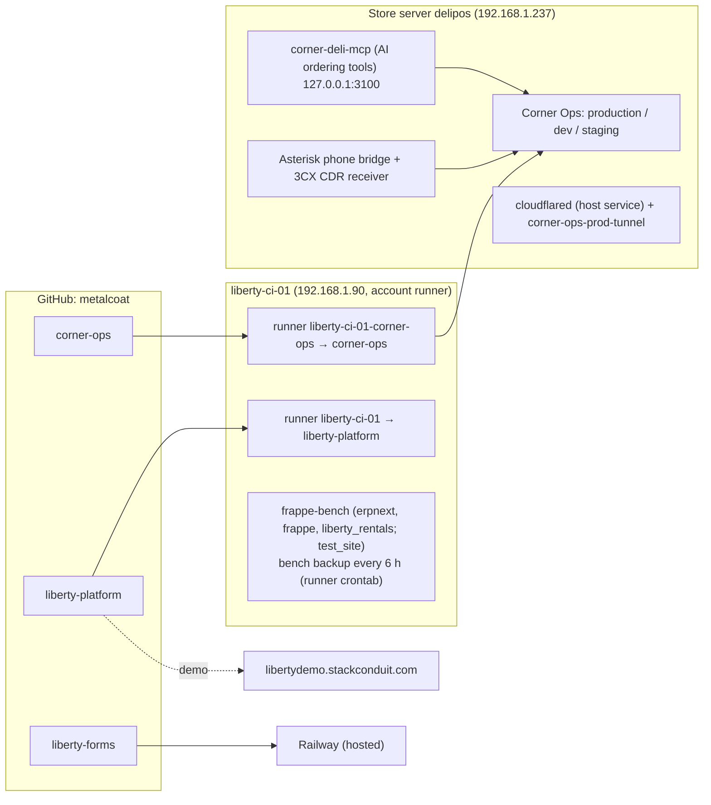
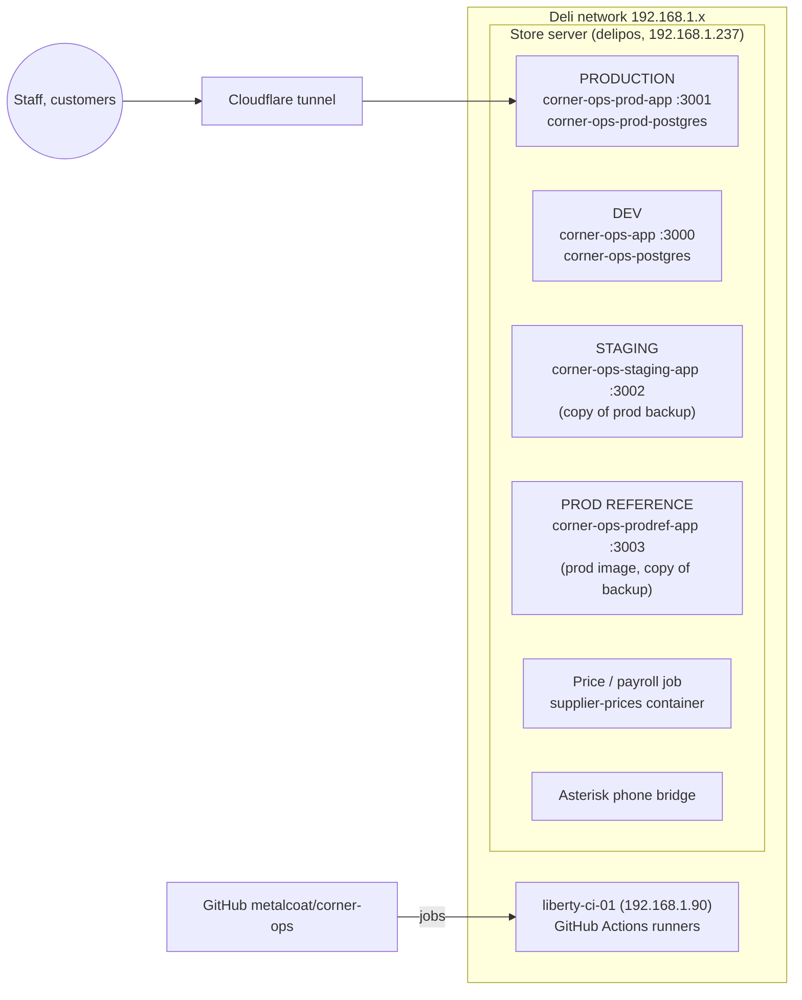
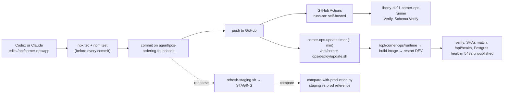
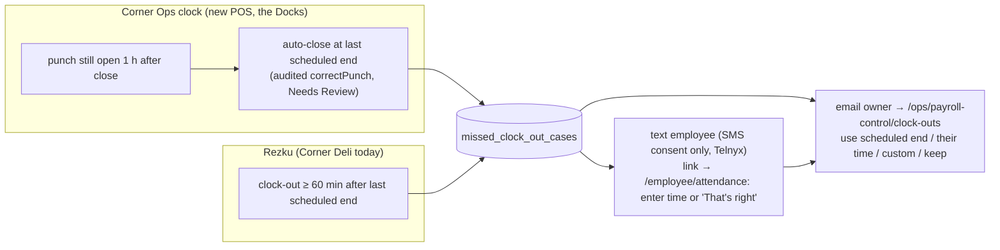
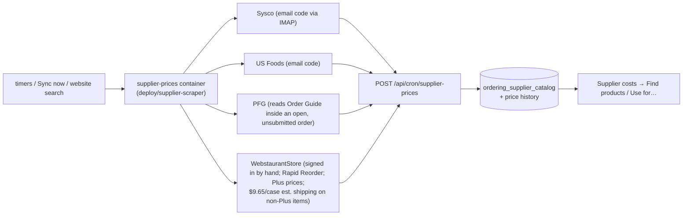
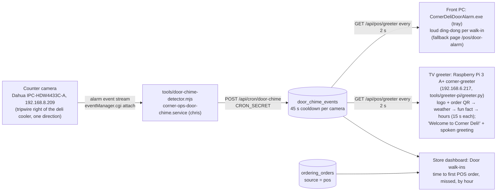
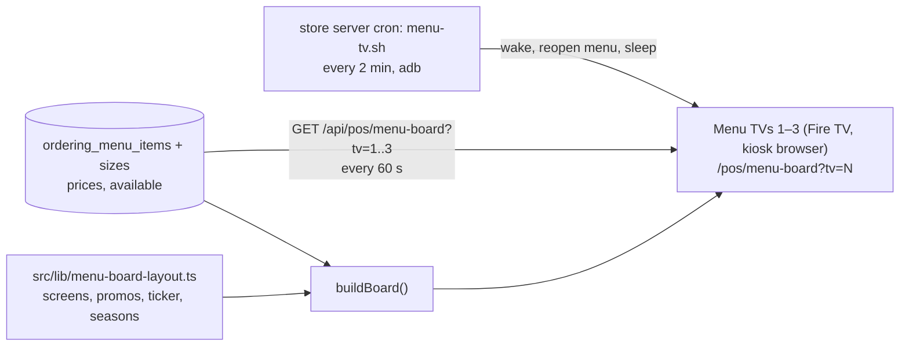
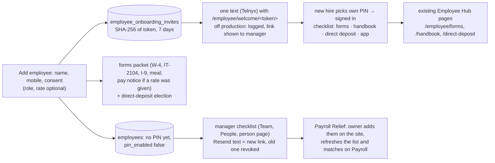
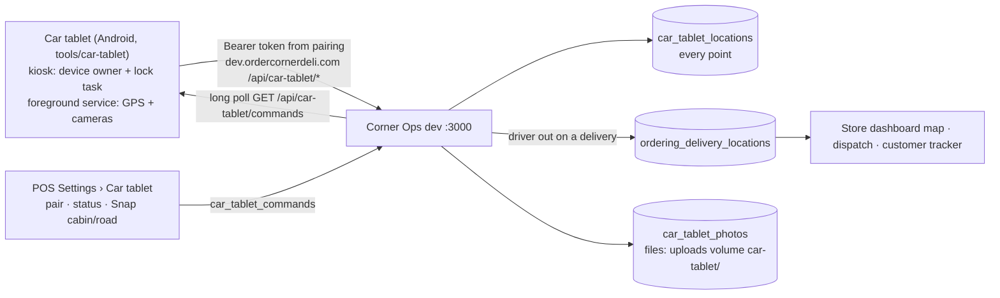

# Corner Ops process map

How code, servers, scheduled jobs, outside services and the weekly business
processes connect. Shared by every assistant (Codex and Claude) and by people.
**Keep it current:** when you change a flow below, update this file in the same
commit. Last full review: 2026-10-12. The software itself (request path, order engine, payments, printing) is in
[ARCHITECTURE.md](ARCHITECTURE.md); online ordering in [online-ordering.md](online-ordering.md); the 2026-10-24
production review in [reviews/2026-10-24-production-review.md](reviews/2026-10-24-production-review.md).

Contents: [All programs](#0-all-programs) · [Machines](#1-machines-and-environments) ·
[Code to running app](#2-code-to-running-app) ·
[Scheduled jobs](#3-scheduled-jobs) ·
[Weekly payroll](#4-weekly-payroll-corner-deli) ·
[Clock-outs](#5-forgotten-clock-outs) ·
[Supplier prices](#6-supplier-prices) ·
[Sign-ins by hand](#7-sign-ins-done-by-a-person) ·
[Outside services](#8-outside-services) ·
[Walk-ins](#8a-entrance-walk-ins-corner-deli) ·
[Car tablet](#8c-delivery-car-tablet-corner-deli-dev) ·
[Guardrails](#9-guardrails-for-assistants) ·
[Open items](#10-open-items-before-the-switch)

---

## 0. All programs



| Program | Repo | Runs on | CI runs on | Notes |
|---|---|---|---|---|
| Corner Ops (Corner Deli + the Docks) | `corner-ops` | store server | liberty-ci-01 (`liberty-ci-01-corner-ops`) | everything below this section |
| AI ordering tools (MCP) | image `corner-deli-mcp:local` | store server, 127.0.0.1:3100 | — | used by the AI phone/ordering line (`OPENAI_ORDERING_MCP_*`) |
| Phone bridge | `corner-ops/asterisk`, `tools/3cx-cdr-receiver.mjs` | store server | with Corner Ops | 3CX ↔ Asterisk ↔ app |
| Liberty Platform (rental operations; SAP B1/Fame replacement) | `liberty-platform` | demo: libertydemo.stackconduit.com; Frappe POC on liberty-ci-01 | liberty-ci-01 | see that repo's README / docs/IMPLEMENTATION.md |
| Liberty Forms (HVAC rental agreements, quotes, signing) | `liberty-forms` | Railway | liberty-ci-01 | SendGrid email; `LIBERTY_MODE=live` for customer use |

Owner direction (2026-10-12): **builds and checks for all programs run on the local runner**
(GitHub Actions orchestrates; jobs run on liberty-ci-01, never GitHub-hosted runners). liberty-ci-01
hosts one runner per repo (a personal account can't share a runner across repos), each a user systemd
service under account `runner` (linger on, no sudo):

| Repo | Runner | Service | Postgres test port on the host |
|---|---|---|---|
| liberty-platform | `liberty-ci-01` | `actions.runner.metalcoat-liberty-platform.liberty-ci-01` (system) | 15432 |
| liberty-forms | `liberty-ci-01-liberty-forms` | `actions-runner-liberty-forms` (user) | 25432 |
| corner-ops | `liberty-ci-01-corner-ops` | `actions-runner-corner-ops` (user) | 35432 |

Jobs share the host, so each repo's workflow publishes its Postgres service on its own port. Browser
system libraries for Playwright must be installed on liberty-ci-01 once by an admin
(`sudo npx playwright install-deps chromium webkit`); workflows skip `--with-deps`/sudo when
`RUNNER_ENVIRONMENT=self-hosted`. New workflows: `runs-on: [self-hosted]` and a free host port.

## 1. Machines and environments



| | Production (current) | Dev | Staging | Prod reference |
|---|---|---|---|---|
| Who uses it | Staff and customers | Development | Rehearsing the switch | Side-by-side checks |
| Address | ops/team.ordercornerdeli.com, team.atthedocks.com (Cloudflare) | 192.168.1.237:3000 | 192.168.1.237:3002 (deli network only) | 192.168.1.237:3003 (deli network only) |
| Code | `/opt/corner-ops/production/release` — a copied folder, **not git**, ≈ `main` + hand edits | `/opt/corner-ops/runtime` = branch `agent/pos-ordering-foundation` | a commit of this repo, `/opt/corner-ops/staging/app` | the image production runs |
| Data | live | dev test data | last nightly prod backup | last nightly prod backup |
| Settings | `/opt/corner-ops/production/.env` | `/opt/corner-ops/.env` | `/opt/corner-ops/staging/.env` (outbound texts/email/push/providers removed, MX sandbox) | same as staging |
| Jobs | chris's crontab | systemd timers | none | none |
| Build / refresh | by hand (compose in `release/deploy/selfhost`) | `deploy/update.sh` (timer, every minute) | `deploy/staging/refresh-staging.sh` | `deploy/staging/start-production-reference.sh` |

Production is the only place with real staff/customer activity. Messaging and
payroll history in production must survive the switch; Rezku and Square are being retired.

## 2. Code to running app



- Milestone steps are in `AGENTS.md` (commit → push → `update.sh --force` as chris → verify).
- AI phone cart mutations reject unknown operations and target persistent `cart_line_id` values returned by the cart. Draft repricing preserves these logical IDs while replacing physical rows atomically; edits resolve modifiers within their catalog groups. Wing flavors come from Wing Sauce, and fries use distinct side/on-fries options. Migrations 0020–0021 add this identity and explicit topping choices. Catalog omissions such as No Tomato are selected when removing a built-in recipe ingredient; generic removals still remove optional add-ons. Batch corrections resolve separate stable line IDs before pricing the whole change atomically; a unique Wing Sauce selection can disambiguate count-only wing corrections, while ambiguous lines require clarification.
- The Verify workflow also runs the dedicated AI suites against a fresh PostgreSQL database and the menu-only fixture under `tests/fixtures/`. This includes cart safety, mocked payment failure/retry and kitchen submission, aliases, follow-ups, conversations, stored regressions, ordering, OpenAI and Gemini routing/schema tests. The Gemini script runs offline in CI; live WebSocket validation remains a separate invocation without `--offline`. Speech recovery waits for generation and outbound playback to finish, and caller interruptions invalidate pending recovery. Gemini keeps the model stored on the call even if settings change later, uses a single Kore voice configuration, and logs the configured model/voice at session start. Migration 0022 moves the affected Corner Deli Gemini preview setting to gemini-2.5-flash-native-audio-latest following reported voice drift; a live setup test with Kore passes, but acoustic consistency still needs a listening check. Since 2026-10-25 the same job also runs `test:ai-cart-regressions` (wing count corrections, sauce cups, recipe omissions/restores, fry toppings, stable modifier order), `test:voice-payment-recovery` (phone card payment: lost MX reply looked up by replayId, amount drift voided, preflight before charging, AGI timeout longer than the MX timeout) and `asterisk/gemini-phone-bridge-test.py` (the Gemini call loop with a fake Live socket: a failed cart change never blocks a corrected one, an identical call repeats only within one model turn, toolCallCancellation is logged, a Gemini session end hands the caller to an employee, talking over the goodbye keeps the call). It also builds the phone image and tests the secure payment line (`asterisk/voice-payment.py`): since 2026-10-25 the caller can say the card number, expiration, security code and zip or key them in at any step. Speech is recognized inside the phone container by Vosk (offline model `vosk-model-en-us-0.22-lgraph`, pinned by checksum in `asterisk/Dockerfile`; card audio never reaches Gemini and nothing heard is logged). A whole number that fails the Luhn check falls back to four digits at a time; the last four are read back for a yes/1. `voice-payment-asr-test.py` (natural-voice clips in `tests/fixtures/payment-voice` through a phone codec; no wrong-but-valid card allowed) and `voice-payment-flow-test.py` (the real EAGI script against a fake Asterisk: spoken, keyed, garbled-then-groups, "no" then Amex, silence) run there. None of these prove real speech or paper printing.
- Gemini phone cost (2026-10-28): Gemini Live re-bills the whole system prompt, tool definitions and conversation on every model turn and has no prompt cache (`BidiGenerateContentSetup` has no `cachedContent`). The menu is never in the prompt (MENU_SEARCH / PRICE_ORDER look it up); the ordering rules in `src/lib/openai-phone-prompt.ts` are kept terse (about 3.7k tokens), tool results are compacted in the bridge (no empty fields or raw cents), and the sliding context window (`GEMINI_CONTEXT_TRIGGER_TOKENS` 40k / target 24k) is on. Each call logs a `gemini.callUsage` event in `ordering_ai_call_events` with tokens by modality, cached and tool-use prompt tokens, message count and estimated USD; each `gemini.toolCallEnd` logs `resultChars`. The OpenAI line logs the same per-call cost as `openai.callUsage` (`src/lib/openai-phone-usage.ts`: tokens by modality incl. OpenAI's automatic cached tokens; input transcription is billed separately and not included). A dev trial of `gpt-realtime-mini` (2026-10-28 to 10-30) was ended: on its one logged call ($0.026 for 43 s, 34k of 41k text tokens cached) it skipped the ordering tool on most turns, talked over the caller, and quoted a $4.00 total and asked cash or card with nothing ordered. Dev is back on Gemini `gemini-3.1-flash-live-preview`.
- Claude phone eval (2026-11-06, text only, dev only): `npm run eval:claude-phone` (`scripts/claude-phone-eval/`) replays scripted caller lines to Claude with the Gemini bridge's instructions and the same ordering MCP tools, called in-process inside a rolled-back transaction (payment, transfer, send and end-of-call stubbed). It also grades the logged Gemini calls the scripts came from. Key file: `/opt/corner-ops/config/anthropic-dev.env` (`ANTHROPIC_API_KEY`). Results: `docs/reviews/2026-11-06-claude-phone-eval.md`.
- Claude order checker on the Gemini line (dev trial 2026-11-06, `AI_PHONE_CLAUDE_CHECKER`, default false, set true in dev `/opt/corner-ops/.env`; compose passes it to `asterisk` and `app`, and the app reads `ANTHROPIC_API_KEY` from the optional `/opt/corner-ops/config/anthropic-dev.env`). Gemini stays the voice. After each successful cart change the bridge asks `POST /api/internal/ai-phone` `claude_check` in the background (`src/lib/ai-phone-order-checker.ts`: Claude Sonnet 5.5, adaptive thinking, low effort, structured output) to compare the saved transcript plus the caller's latest unsaved words with the cart. A mismatch note rides on Gemini's next tool result, or goes in as a private nudge once Gemini and the caller are quiet. Before `hold`, `send` and `request_secure_voice_payment` the bridge waits up to 1.5 s for the newest check and returns the note as an `ORDER_CHECK` error, once per note and at most twice per call. A checker error or timeout never blocks the call. Every check is logged as `claude.orderCheck` in `ordering_ai_call_events` (shown in the POS AI call monitor), with bridge events `gemini.orderCheck*`. Proof: `npx tsx scripts/claude-phone-eval/checker.ts` (the 8 logged dev Gemini calls) and the checker cases in `asterisk/gemini-phone-bridge-test.py`.
- AI phone fixes from Chris's dev test call 2026-11-06:
  - Gravy can go on the fries again (migration 0037 turns "Gravy on Fries" back on). On a standalone fry, plain "gravy" is on the side and "on the fries" / "on top" is on the fries.
  - A hot meat meal is one container. The AI asks once whether the caller wants gravy on the chosen side ("Would you like gravy on the fries?", or PRICE_ORDER's "Gravy on the mashed potatoes?"). A yes puts it on top, and it's always charged. Gravy goes on the side only if the caller asks for that.
  - Nacho cheese is always on the side; an on-top request lands on the side instead of erroring.
  - A bare yes, sure or yeah to a list question (dips, sub vegetables) means all of it.
  - A caller who asks for a person (person, representative, operator, the store) or sounds frustrated ("this isn't working", swearing, "no no no") is transferred right away with "No problem, let me get you to someone at the store." On the Gemini line the bridge spots the words itself (`person_handoff_reason`), tells Gemini the line, and transfers on its own if Gemini hasn't within 6 s. On the card line the words are in every step's vocabulary (`transfer-person`, code `caller_asked_for_person`). The popup shows "Caller asked for a person" or "Caller sounded frustrated".
  - The card line writes one `VOICE_PAYMENT_STEP` line per step to the asterisk container log: keys, speech or nothing; whether speech was detected; peak loudness; and only the word and digit counts, never what was said. The card number gets a second opinion when `VOICE_PAYMENT_SECOND_OPINION` is true (dev): LFM3-Audio-2B (Q8_0 GGUF, pinned by checksum in `asterisk/Dockerfile`) served by llama.cpp inside the phone container on 127.0.0.1:18090. It only receives the audio of the answer just given, never stores it, and its request logging is off.
  - Agreement, or no second opinion, keeps Vosk's reading.
  - Two different readings trust neither, so the number is asked again.
  - If Vosk has no answer, the second opinion's reading is used only if it has the right length, and the whole card still must pass Luhn.
  - Each step logs `VOICE_PAYMENT_SECOND_OPINION step=… outcome=agree|disagree|rescued|vosk_only|none`.
  - Benchmark (2026-11-06, 200 synthetic phone-codec groups, clean/quiet/noisy/fast): Vosk 167 right, 7 wrong. LFM3 188 right, 1 wrong, about 1.5 s per answer; it disagreed with all 7 wrong Vosk groups and rescued 20 of 26 misses. Whisper small.en scored 185 but took 2.1 s, and Gemma 4 E2B took 3.7 s; neither was used.
  - LFM Open License: commercial use allowed below USD 10M annual revenue.
  - The image grows by about 2.5 GB.
- From Chris's dev test call 2026-11-06 (f98e637f):
  - If Gemini hears the caller start talking but never decides they've finished, the stall watchdog sends `realtimeInput.audioStreamEnd` before its nudge (checked live on `gemini-3.1-flash-live-preview`), so Gemini answers instead of sitting silent.
  - Topping names the voice model mangles still resolve: doubled words ("Hot Hot Peppers"), a group-name suffix ("Bacon Pizza Topping"), and sweet / green / bell peppers as Peppers.
  - Extra or light sauce adds the Extra Sauce topping.
  - An edit with an unknown modifier names it ("Purple Peppers isn't an option on that") instead of the vague "invalid or ambiguous". Test: `scripts/ai-cart-regressions/pizza-names.ts`.
  - Pickup or delivery is confirmed once ("Delivery to 412 Jay Street, right?"), then never asked or re-read again. Once an order has pickup or delivery set, `price_order` refuses a switch (`SERVICE_ALREADY_SET`) unless `serviceChangeRequested` is true, which means the caller clearly asked to switch. Test: `scripts/ai-cart-regressions/service-type.ts`.
  - From Chris's 14:18 test call, 2026-11-06:
    - The bridge unsticks a frozen caller turn after `GEMINI_UNSTICK_SECONDS` (2.5 s) with no model activity: it sends `audioStreamEnd` plus the caller's own words as text ("The caller said: …"). The 8 s stall nudge stays as a backstop.
    - The prompt now asks for short per-item acknowledgements ("Got it, what else?"), no read-back until the end, and no "everything on that?" when the caller already named a change.
    - The card line opens with "Okay, let's get your card."
    - The quick whole-number try isn't a strike.
    - The second opinion checks only four-digit groups, including a group Vosk heard as nothing. LFM3 took 3.6 s and miscounted repeated digits on a whole number.
    - A group the line couldn't get is asked for again with the keypad prompt "Please type those digits on the keypad" (`type-group`). It still listens for speech too.
    - The second opinion is held to exactly that many digit words by a llama.cpp grammar (`digits_grammar`).
  - Wording fixes from Chris's 19:41 test call:
    - Never two questions in one turn.
    - Choices are asked plainly ("What sauce on the wings?") without reading the option list, and nothing already answered is re-asked.
    - The pickup goodbye is built by `pickupClosing()` from the wait message.
    - Pizza lines are said as "jumbo pizza with …", without Classic Sauce / Regular Cooked.
    - The bridge's silence nudge tells the caller-thinking case (the AI spoke last: wait `GEMINI_CALLER_THINKING_SECONDS`, 20 s, then only "Take your time.") apart from Gemini not answering (answer what the caller said). It never re-asks the question.
    - Test: `scripts/ai-cart-regressions/wording.ts`.
- Docker disk cleanup: `update.sh` prunes after each deploy, but only untagged images and build cache older than 72 h, so tagged leftovers piled up. The box got down to 1.6 GB free on 2026-11-06, and 9 GB was freed by hand that day.
  - `deploy/docker-cleanup.sh` removes untagged images, build cache beyond 5 GB, and unused `corner-ops-*` tags older than 14 days. It keeps `:latest`, `:rollback` and `:before-*`, never touches containers, volumes or base images, logs to `deploy/logs/docker-cleanup.log`, and warns when less than 8 GB is free.
  - `--dry-run` lists what it would remove.
  - It runs daily at 04:40 from chris's crontab (added by Chris 2026-11-06), using the runtime copy.
  - Under 8 GB free it emails the owner at most once a day (`ALERT_TO_EMAIL`, else `APP_EMAIL`), using the app's SMTP settings (`deploy/send-alert-email.py`). The email includes a plain-English list of what's using space, largest first, each marked safe to clean or keep (`deploy/disk-usage-summary.py`).
  - `--test-alert` sends that email once without cleaning anything.
  - Phone cart results carry `wingReadback` ("10 wings mild, 10 wings garlic parm, and blue cheese and celery with those") and the prompt reads wings that way.
  - The secure card line hands the caller to staff on the second failed answer of any kind with "Sorry, we must be having an issue. I'm transferring you to someone who will take your card number." (`transfer-card-help`). Before, it allowed up to about 15 retries.
  - A failed card payment leaves the call `handoff_pending` with a readable reason (`src/lib/ai-handoff-reason.ts`), so the POS "AI PHONE ORDER · NEEDS STAFF" popup shows why, plus the order and total. Before, the call was marked ended and the popup never appeared.
  - Tests: `test:ai-phone-handoff`, `scripts/ai-cart-regressions/hot-meal-gravy.ts`, and case 7 of `asterisk/voice-payment-flow-test.py`.
- Menu changes from Chris 2026-11-06 (dev; production gets them with the menu copy at the switch):
  - Burgers come plain. A "Deluxe" group (lettuce, tomato, onion) is on all 12 burgers and costs $0.25 once for any
    or all of them. Migration 0038 adds `ordering_modifier_groups.selection_charge_cents`, a fee charged once when
    anything in the group is picked; `src/lib/ordering-modifier-pricing.ts` is the one rule the server, POS, online page
    and send-time price check share. The fee is stored on the first selected option's order snapshot, so receipts,
    refunds and totals add up as before (itemized receipts now show charged modifiers, e.g. "Lettuce +$0.25"). The
    menu editor's group row has a "Charge once" field. Lettuce, Tomatoes and Raw Onions are switched off in Burger
    Toppings. The AI phone puts spoken lettuce/tomato/onion in Deluxe; "cheeseburger deluxe" still adds mayo and
    pickles too (owner rule 2026-10-25). Set up by `scripts/configure-burger-deluxe.ts` (rerunnable; CI runs it on the
    menu fixture), checked by `npm run test:burger-deluxe`.
  - Pepperoni Chicken Parmesan Sub $12.50 (was $11.50): `scripts/configure-pepperoni-parm-price.ts` (rerunnable).
- **Database schema** (2026-10-23): tables, columns, indexes and constraints come only from `db/migrations/*.sql`;
  app code never runs `CREATE/ALTER/DROP` (CI `verify_no_runtime_ddl.py`). The `ensure…Schema()` functions that
  remain only seed rows and fix data. `tools/db-migrate.sh --container NAME` applies new files in order, each in
  one transaction, recorded in `schema_migrations` with its git blob hash (production's existing format); a file
  that changed after it was applied stops the run, so changes go in a new file. `update.sh` runs it against
  `corner-ops-postgres` before restarting the app, `refresh-staging.sh` after restoring the backup.
  `--adopt` is the one-time first run on a database the app built for itself (dev was adopted 2026-10-23,
  backup first at `~/.local/state/dev-db-before-migrations-*.dump`); `--status` lists applied/pending.
  `0014_runtime_schema.sql` was captured by running every old `ensure…Schema()` on a 0001–0013 database.
- **GitHub Actions only orchestrates; jobs run on the deli's own runner.** liberty-ci-01
  hosts two runners: `liberty-ci-01` (repo `metalcoat/liberty-platform`) and
  `liberty-ci-01-corner-ops` (this repo; labels `self-hosted, Linux, X64, liberty-ci, corner-ops`),
  a user systemd service `actions-runner-corner-ops` under account `runner` (linger on; no sudo).
  The store server reaches it as `ssh liberty-ci-01` (key `~/.ssh/liberty_ci_ed25519`).
  Workflows must use `runs-on: [self-hosted]`; never GitHub-hosted runners.
- Vercel and Neon are retired (project paused, Neon removed). Nothing should deploy there.
- After builds, dangling Docker images older than a day are pruned (the disk filled once).

## 3. Scheduled jobs

| Job | Production (crontab → :3001) | Dev (systemd timer → :3000) |
|---|---|---|
| Nightly backup | 02:20 `backup_prod.sh` → `production/backups` | `corner-ops-backup.timer` |
| Off-site copy (encrypted, Google Drive) | 07:50 UTC chris's crontab: `deploy/offsite-backup.sh` (from runtime) copies the newest prod + dev backups and the `.env`/config files to Drive folder "Corner Ops backups" through the rclone `crypt` remote `cornerops-offsite`; keeps 30 days. Passwords: owner's password manager (server copy `/opt/corner-ops/config/offsite-backup-passwords.txt`). Log `~/.local/state/offsite-backup.log`. | (included) |
| Scheduler (payroll capture, weather, missed shifts, overtime, bank sync, expenses) | 07:00 and 08:00 UTC | `corner-ops-cron-scheduler.timer` |
| Schedule delivery (schedule texts/emails) | every 5 min | `corner-ops-cron-schedule-delivery.timer` |
| Rezku repair | every 15 min (**remove at switch**) | — |
| Ordering maintenance (print retries, abandoned reopens, terminal capture) | **not yet** (add at the switch; until then it runs only while a KDS is open) | `corner-ops-cron-maintenance.timer` (every minute) |
| Interim Monday payroll email (until the switch) | 12:00 + 13:00 UTC Mondays → acts at 8 AM Eastern: `deploy/staging/monday-payroll-preview.sh` (fresh backup → staging → puts back the saved Payroll Relief employee list + matches, `staging/payroll-relief-{roster,matches}.json` → email owner; approve on staging) | — |
| Missed clock-outs + Monday payroll (8 AM / 5 PM) | **not yet** | `deploy/systemd/corner-ops-cron-missed-clock-outs.timer` (every 15 min; in the repo but **not installed** as of 2026-10-24; install with `install-timers.sh`) |
| Supplier price files + Sync now + website searches + payroll sends | — | `corner-ops-supplier-prices.timer` (every 5 min) |
| Supplier website prices | — | `corner-ops-supplier-website.timer` (twice daily) |

## 4. Weekly payroll (Corner Deli)

The Docks (Tiki) is a separate, seasonal company: summary only, never sent automatically.

```mermaid
flowchart TD
  rz["Rezku daily labor report email<br/>(Sunday's often arrives Monday morning)"] --> rs[(rezku_shifts)]
  pos["New POS clock (after the switch)"] --> te[(time_entries)]
  rs --> sum["payrollSummary (payroll-summary-rules.ts)<br/>regular · tipped (driver) hours · tips · OT"]
  te -. "after switch: Corner Deli hours<br/>must come from here (open item)" .-> sum
  sched[(schedule_shifts)] --> cmpw["Scheduled vs worked<br/>(payroll-schedule-compare.ts)"]
  sum --> d["Monday: draft for last week"]
  cmpw --> d
  d --> e8["08:00 Mon email to PAYROLL_NOTIFY_EMAIL<br/>hours, tips, what's off, blockers<br/>(waits for Sunday until 12:00)"]
  e8 --> win{"Before 17:00:<br/>fixes / Hold?"}
  win -->|Hold or blocked| ns["'Not sent at 5 PM' email<br/>owner approves on /ops/payroll-control"]
  win -->|clear| a5["17:00 recalculate → approve & lock<br/>'Automatic 5 PM approval'"]
  ns --> a5m["manual Approve & lock"]
  a5 --> q[(payroll_submissions)]
  a5m --> q
  q --> pr["payroll-relief.mjs on the store server<br/>sign in (texted code → code box on payroll page)<br/>check period · download Excel timesheet · fill · upload<br/>check totals · Save"]
  pr --> sub{"PAYROLL_RELIEF_AUTO_SUBMIT=1<br/>and submit_after_save?"}
  sub -->|no (default)| saved["status 'submitted' = saved<br/>owner presses Submit in Payroll Relief"]
  sub -->|yes| send["press 'Submit' once → verify<br/>status 'sent' → Whalen, Davey & Looney"]
```

- Payroll website: AccountantsOffice → **Payroll Relief** (IRIS), employer *Mike's Corner Deli, LLC*,
  submission method *Excel Timesheet*. Columns filled: Reg, TipWa (tipped/driver hours),
  PCTip (tips incl. manual), OT. Salaried rows, Sick, SPOH, Overpay are never touched.
- Employee matching (Corner Ops payroll name → Payroll Relief EE #) is on the payroll page.
- Dry run (fills the file, uploads nothing): `supplier-prices-sync.sh --payroll-dry-run <weekStart>`.
- Payroll Relief behaviour (seen on the real site, 2026-10-12, week 10/5–10/11):
  - "Download Excel" is `GET https://app.payrollrelief.com/Payroll/CreateCsv?sendEmail=false` (sendEmail=true emails it — never use).
    The job fetches it directly; Chromium's download handling crashed in the container.
  - **Uploading the Excel timesheet stores the entries immediately**; Save stays greyed out. The job verifies by
    re-downloading the stored timesheet and comparing totals; it never re-runs after an upload.
  - After the owner pressed Submit, the current payroll moved to the next week (#44) and the submitted one appeared
    under Approved as "10/16/2026 - 43 - Normal" (pay date - number - type). The job's Submit check relies on this.
  - Nightly backups (02:20 UTC = 10:20 PM Eastern) run before Rezku's 11:01 PM Eastern labour report, so each
    backup misses that day's hours; the interim Monday email takes its own fresh backup.
  - The AccountantsOffice session lasts a few hours; most Mondays need the texted code (code box on the payroll page).
    Since 2026-10-19 it first asks "Select verification method" (text / call); the job picks the text message.
  - Chromium leaves `Singleton*` lock files after a crash; jobs clear them before launching (one job at a time).
- Automatic Submit stays **off** until a first Submit has been watched together.

## 5. Forgotten clock-outs



- Rezku always closes shifts (no NULL clock-outs in history), so "late clock-out vs schedule" is the Rezku signal.
- Production hook still to add: after a Rezku shifts import in production's `safe-rezku-import.ts`, call
  `runMissedClockOutCheck({ sources: ["rezku"], rezkuBatchId })`.

## 6. Supplier prices



- "Search supplier websites" queues a term (`ordering_supplier_site_searches`); the job searches each site's own search.
- Prices reach stock items only once linked ("Use for…"). Dev has no stock items yet (open item).

## 7. Sign-ins done by a person

Some sites need a human (robot check or texted code). `supplier-prices-sync.sh --signin <site>`
opens the job's own browser on a virtual screen as a web page **on the deli network only**
(`http://192.168.1.237:6080/vnc.html…`, one-time password, 15 minutes). The saved session
(profile in Docker volume `corner-ops_cornerops_supplier_browsers`, plus session cookies) is reused.

| Site | Why | How long it lasts |
|---|---|---|
| WebstaurantStore | reCAPTCHA | long |
| AccountantsOffice | code texted to the owner | ~hours; Monday sends ask for the code on the payroll page |

Never automate around robot checks.

## 8. Outside services

| Service | Used for | Where configured |
|---|---|---|
| MX Merchant (Dharma) | card payments, terminal (Terminal API + Checkout API) | `MX_*` in .env (dev: sandbox) |
| Telnyx | texts to staff/customers (consent required) | `TELNYX_*` |
| SMTP / Resend | email (Resend account came through Vercel; keep it) | `SMTP_*`, `RESEND_*` |
| Web push | app notifications (subscriptions record their web address) | `PUSH_VAPID_*` |
| Plaid | bank feeds | `PLAID_*` |
| 3CX / Asterisk | phones, missed-call alerts, AI ordering line | `THREE_CX_*`, asterisk service |
| Cloudflare tunnel | public access to production | `corner-ops-prod-tunnel` (do not modify) |
| Sysco, US Foods, PFG, WebstaurantStore | supplier prices | `*_USERNAME/_PASSWORD` |
| AccountantsOffice / Payroll Relief | payroll entry | `ACCOUNTANTSOFFICE_*`, `PAYROLL_RELIEF_AUTO_SUBMIT` |
| GitHub + liberty-ci-01 | source control, CI | runner service on liberty-ci-01 |

## 8a. Entrance walk-ins (Corner Deli)



- Nothing shows on the POS screens; this only measures. Each POS order started is matched to the oldest walk-in still
  waiting (first come, first served). No order within 10 minutes = missed. Online, kiosk and AI-phone orders don't count.
- The front door (logo door) is at the back of the camera view, behind the deli cooler; people crossing the line by
  the cooler toward the customer side count as walk-ins. Staff crossing it count too.
- Camera rules now: two one-way tripwires, DoorIn (at the logo door) and DoorIn2 (under the front window, past the
  deli cooler); a person crossing both counts once (45 s cooldown). The listener reconnects every 5 minutes because
  the camera can leave an open alert connection silent after its rules are edited.
- Camera login lives in `/opt/corner-ops/config/door-camera.env` (never committed); see the detector's header for settings.
  `--probe` shows the device and its detection rules. Camera settings backup: `/opt/corner-ops/config/door-camera-backup-*.txt`.
- TV greeter: the Pi (user chris, SSH key `~/.ssh/corner_greeter_ed25519` on the store server) runs
  `tools/greeter-pi/greeter.py` from labwc autostart (Chromium is too heavy for its 512 MB). It shows
  `public/greeter/idle.png` / `welcome.png` (rendered from `/pos/greeter`) and plays `welcome.mp3` to HDMI.
  The QR points at `GREETER_ORDER_URL` (default https://ordercornerdeli.com).
- TV power: the greeter Pi switches the TV over HDMI-CEC from cron (`tools/greeter-pi/tv-power.sh`): on 10:20 AM
  daily, off 9:35 PM Sun–Thu and 10:35 PM Fri–Sat. Change these with the store hours.
- TV hours slide: `src/lib/greeter-hours.ts` (Sunday first; Sun–Thu 10:30 AM–9:30 PM, Fri–Sat 10:30 AM–10:30 PM
  as of 2026-10-19), drawn by `GET /api/pos/greeter/hours` with today's row picked out; the Pi fetches it with the
  weather. Not linked to online-ordering hours (ordering_business_hours is not set up yet).
- TV fun facts: `src/lib/greeter-facts.ts` (edit freely; keep them short and true). `HOLIDAY_FACTS` there replace them
  during a season; the weather, fact and hours pictures take `?season=` for holiday colors (`src/lib/greeter-palette.ts`). `GET /api/pos/greeter/facts`
  gives the count and a version; the Pi downloads `GET /api/pos/greeter/fact?n=` pictures again when the version
  changes (checked at start and every 6 hours).
- TV weather slide: `GET /api/pos/greeter/weather` draws a PNG from api.weather.gov (forecast for the Ogdensburg
  gridpoint, current reading from KOGS, else KMSS), cached 20 minutes; keeps the last good forecast if weather.gov
  is down. Requests identify as `CornerDeli-TV/1.0 (ordercornerdeli.com)`.
  The picture leaves the sky beside the temperature and a corner of each day card plain; the Pi animates the weather
  there (sun, moon and stars, clouds, rain, snow, lightning, fog), placed by `GET /api/pos/greeter/weather/info`
  (`src/lib/greeter-weather-layout.ts`). Only those areas are redrawn, about 12 times a second.
- Curbside check-in: on the order page a curbside customer picks car color and type and taps I'M HERE
  (`POST /api/customer/orders/[id]/arrival`, table `ordering_curbside_arrivals`). Only the back PC's door alarm
  (`tools/door-alarm-windows`) alerts: it polls `GET /api/pos/greeter/arrivals` (store network only), rings its built-in
  curbside bell once per new car and keeps a card (car, name, order number) in an always-on-top, click-through panel in
  SmartPSS's right-hand camera column (config.json `popup`). The greeter TV out front shows nothing for curbside.
  Every Deli POS screen shows a CURBSIDE WAITING banner per car (`GET /api/ordering/curbside`), also on the curbside
  order in Orders; DELIVERED TO CAR (`POST /api/ordering/curbside`) records who and when (`delivered_at`/`delivered_by_*`,
  and a `curbside_delivered` order event in Who did what) and the card leaves the back PC (also when the order is
  completed or after 20 minutes).
- Front PC door alarm: `tools/door-alarm-windows` (Go tray program, download
  `/downloads/CornerDeliDoorAlarm.zip`), started from the PC's shell:startup folder.
- `/api/pos/greeter` is read-only and unauthenticated but store-network only; it returns just the newest
  walk-in's id, kind and age.
- Camera clock: GMT-4 with time server sync and its own DST rule off (the firmware ignores it); set GMT-5 on the
  first Sunday of November and GMT-4 on the second Sunday of March.
- Dev only so far (port 3000). `corner-ops-door-chime.service` is installed and enabled on the store server (seen 2026-10-24).

## 8b. TV menu board (Corner Deli)



- Three menu TVs rotate menu screens (12 s) and promo screens (8 s) with a crawling ticker, all in step: every TV
  has four slots and counts them (and the ticker) from the server's clock (`serverNow` in the API). Items are named
  "POS category|POS item", so prices and sold-out marks come straight from the POS; a changed price flashes. A promo
  whose item is sold out or missing gives its slot to the order-ahead screen. Missing items are listed in the API's `missing`.
- Seasons by store date (America/New_York): Halloween 10-21–10-31, Thanksgiving 11-12–11-26 (free turkey dinners on
  Thanksgiving Day), Christmas 11-27–12-25 (gift cards). `?season=` previews one; `?motion=low` calms a slow TV.
- Store-network only, like the rest of `/pos`. Fonts and the promo photos are in `public/menu-board/`.
- The TVs are Hisense Fire TVs (TV 1 192.168.6.162, TV 2 .247, TV 3 .231) running the Corner Deli display app
  (`tools/display-app`, replaced Fully Kiosk on 2026-10-22; Fully is still installed but disabled). The store
  server's cron runs `tools/menu-tvs/menu-tv.sh` every 2 minutes over adb: during store hours it wakes a TV that is
  off and reopens the menu if anything else is on screen; from closing until 10:20 it keeps them asleep
  (on 10:20 AM, off 9:35 PM Sun–Thu, 10:35 PM Fri–Sat, Eastern). Log: `~/.local/state/menu-tv.log`. Runs the dev app.
  Asleep, the Fire TVs drop off the network for long stretches (2026-10-22: woke 6–18 min late), so a Pi on each TV's
  HDMI wakes it at 10:19 over CEC (`tools/greeter-pi/tv-power.sh wake`, keeps the TV's own input); the server then
  opens the page. The greeter Pi does this now; the menu TVs' Pis still need setting up.

- Greeter on the Fire TV (192.168.6.83, Corner Deli display app): `http://192-168-1-237.nip.io:3000/pos/greeter/tv`
  (a name, not the bare IP, because YouTube won't play embeds on IP-address pages) is the web greeter with the same slides as
  the Pi (logo + QR, weather, fun fact, hours, 15 s each), the walk-in welcome and sound, and the menu board's
  seasons. Background music: a YouTube playlist per season from `src/lib/greeter-playlists.ts` (shown in a small "Now
  playing" card, since YouTube's player must stay visible); without playlists, audio files in the uploads volume under `greeter-music/<season>/` (halloween,
  thanksgiving, christmas) or `greeter-music/everyday/` (`GET /api/pos/greeter/music?season=`); it pauses for each
  welcome. Music and welcome volumes (0–100, table `greeter_tv_settings`) are set in POS Settings › Operations and
  reach the TV with each walk-in poll (`GET /api/pos/greeter` returns `volumes`). On NFL game days an "NFL today" screen (kickoffs, live scores, finals; Bills picked out) comes round
  twice per turn, from ESPN's public scoreboard via `GET /api/pos/greeter/nfl` (`src/lib/greeter-nfl.ts`). During the Halloween season the logo and welcome screens
  get a spooky night scene (`src/app/pos/greeter/tv/spooky-scene.tsx`; menu TVs unaffected) and the walk-in welcome plays `public/greeter/welcome-halloween.mp3`. `GET /api/pos/greeter` also returns today's season and the TV reloads as soon as it
  changes, so a holiday ends at store midnight rather than at the 4 AM reload. Switched over 2026-10-22: `menu-tv.sh` also wakes this TV and keeps
  the greeter page on it; the Pi greeter program still runs on HDMI but isn't shown, and the Pi only keeps its CEC
  "off" lines as a backup.

## 8b-1. Corner Deli employee app (Android)

`tools/team-app`: a Trusted Web Activity named Corner Deli (`com.cornerdeli.team`) that opens
`https://team.ordercornerdeli.com/employee`, the employee hub, in Chrome with no URL bar; hub push shows as the app's
notifications. Sideloaded from `https://dev.ordercornerdeli.com/downloads/corner-deli-team.apk` (uploads volume,
`tools/team-app/publish-dev.sh`). The URL bar only goes away when production serves `public/.well-known/assetlinks.json`
on the team domain (allowed in `src/lib/team-domain-routing.ts`). Signing key: `~/.config/corner-ops/team-app.jks`.

## 8b-2. People section and new-hire onboarding

Ops menu **People** has one row of tabs on every People page (`src/app/global-nav.tsx`):
Team (`/ops/people/team`, each person at `/ops/people/team/<id>?business=…` with Onboarding, Profile & access,
Paperwork, Pay & payroll, Schedule tabs) · Add employee (`/ops/people/add`) · Paperwork (`/ops/people/paperwork`,
direct deposit at `/ops/people/paperwork/direct-deposit`) · Handbook (`/ops/people/handbook`, Corner Deli) ·
Schedule (`/ops/workforce`) · Attendance (`/ops/attendance`) · Payroll (`/ops/payroll-control`).
The old URLs `/ops/employees`, `/ops/employment-forms`, `/ops/direct-deposit`, `/ops/employee-handbook` redirect
(`next.config.ts`).



- Code: `src/lib/employee-onboarding.ts` (database), `employee-onboarding-rules.ts` (token, text, checklist),
  APIs `/api/employee-directory/onboarding` (managers, workforce permission) and `/api/employee/onboarding` (the link).
- Text log-only: no Telnyx settings, or `ONBOARDING_SMS_LOG_ONLY=true`; numbers in `SMS_TEST_NUMBERS` still send.
- The new hire's steps run in order (PIN → forms → handbook → schedule app; direct deposit optional): a later
  step shows locked until the earlier one is done. Every Employee Hub page shows a "setup isn't finished" banner
  (`/employee/setup` is the signed-in checklist).
- Daily reminder text from the day after the setup text, 10 AM–7 PM Eastern, at most 7
  (`employee_onboarding_reminders`, migration 0041), sent by the every-5-minute `schedule-delivery` cron. Before
  the PIN is chosen it carries a fresh setup link; after, `/employee/setup`. It says they can't be scheduled yet.
- Scheduling gate (`assertOnboardingAllowsScheduling`, `src/lib/workforce.ts`): a person who came in through Add
  employee can't be given a shift (create, edit, open-shift claim) until their own steps are done. Staff never
  sent a setup link are unaffected. Store-side items (I-9 review, Payroll Relief match) don't block scheduling.
- "Schedule app" is done once they sign in with their PIN from the app or Hub (`app_signed_in_at`, migration 0042,
  set by `POST /api/employee/session`). Payroll Relief's step shows only where its tables exist (not production yet).
- A link works for one person only; a resend revokes the older link. After the PIN is chosen the link needs that
  person's PIN to show the checklist again. Nothing is uploaded to Payroll Relief.
- Handbook sections 12 (alcohol, zero tolerance) and 13 (no smoking/vaping) are marked draft until Chris approves
  the wording; any handbook change asks every employee to sign again.

## 8c. Delivery car tablet (Corner Deli, dev)



- Pairing: a manager presses **Pair car tablet** in POS Settings › Car tablet; an 8-character code (and QR,
  `cornerops-car://pair?...`) works once for 15 minutes. The tablet trades it for a long-lived token (only its SHA-256
  is stored, `car_tablets.token_hash`); **Unpair** revokes it. Migration 0027.
- The driver signs in on the tablet with their POS PIN (rate-limited); with nobody signed in the tablet works for the
  only Driver on the clock. It then acts as that driver through `ordering-driver-delivery.ts` (claim, picked up =
  PICKED_UP + EN_ROUTE, arrived, delivered), so audit, tracking links and the customer text work as on the phone.
- GPS: points every ~5 s while moving, queued on the tablet (SQLite) and sent in batches of up to 500
  (`POST /api/car-tablet/locations`, idempotent per point id). All go to `car_tablet_locations`; points during an active
  tracking session are also copied into `ordering_delivery_locations` (`client_event_id` `car:<point>:<delivery>`).
- Photos: front camera = cabin, rear camera = road (through the windshield), JPEG, no audio ever. Reasons: manual,
  delivery_complete (taken when the driver taps Delivered; also saved as the delivery's proof photo, which no-contact
  orders need), remote_request (POS **Snap cabin/road/both**, on the settings page and on delivery orders in Order Center;
  managers only). Files are in the uploads volume, so the nightly `backup-db.sh` uploads archive includes them.
- GPS stops (2026-10-29, `stopTransitions` in `src/lib/car-tablet-rules.ts`): a point within 60 m of an on-the-way
  delivery's address at ≤2.5 m/s marks it ARRIVED (and asks the tablet for a road photo saved as the proof photo);
  driving 200 m away after a stop of ≥20 s marks it DELIVERED (customer text as usual). Notes in the delivery audit say
  "GPS: …". A no-contact order without its proof photo stays ARRIVED.
- Street routing (2026-10-29): `src/lib/delivery-street-router.ts` plans each driver's round trip from the deli on
  `src/lib/route-map/ogdensburg.json` — OpenStreetMap roads with one-ways and traffic lights, plus the owner's stop
  signs and preferred/avoid streets from the "Ogdensburg Stop Sign Map" claude.ai artifact
  (https://claude.ai/artifact/AkqCd4pFzQiY9AnBqah8rM; preferred Jay/Greene/Lafayette, avoid Knox/Montgomery). Each
  stop sign costs 12 s, a light 20 s; preferred streets cost ×0.65, avoid ×2.5. Stops: due-soon orders first, then
  cheapest, improved by 2-opt; back to the deli. Google Maps links pin spare waypoints (up to 9 in all) onto
  preferred streets. Used by the store dashboard (blue line, loop minutes, stop signs, % preferred), dispatch and the
  car tablet; falls back to the straight-line planner off the map. Avoid streets are closed (owner 2026-10-29: "we don't
  want it driving on those streets if deliveries aren't going that way") except the last/first 250 m to a stop on one.
  Google Maps can't follow those rules, so the tablet (app 1.1.0) has its own Drive screen: street map downloaded once
  (`GET /api/car-tablet/streets`), route + turn-by-turn steps from `POST /api/car-tablet/route`, heading-up map,
  spoken directions (Android text-to-speech), re-route after 3 off-route fixes, GPS every second while driving.
  Google Maps stays as a backup button. Testing: POS Settings › Route tester (`/pos/deli/settings/route-test`,
  `POST /api/ordering/car-tablets/route-preview`) plans any address and simulates the drive with the tablet's
  wording in the browser; the tablet's staff menu has "Test drive" (pretend car along the route, app 1.1.1). To refresh after
  the owner edits the artifact: export its `stops` and `streets` and rerun `tools/route-map/build-route-map.py`.
- Belmont Courts (2026-10-29): `src/lib/complex-buildings.ts` + `src/lib/route-map/belmont-courts.json` (owner's
  hand-drawn site map matched to OSM outlines; 17 buildings, Courts 100–400, unit ranges like 151–158). A delivery
  in the complex with a 3-digit unit (unit line, "Apt/#/Unit 153" or "Belmont Courts 153"; the complex's own "436" is
  not a unit) shows "Bldg 151–158 · Court 100" on the tablet and route cards, and Navigate, route stops and GPS stops use
  that building.
- Heartbeat every 30 s (battery, charging, network, signal, app version, queue sizes); online = heard from in 90 s.
  Shown on the store dashboard strip and the settings page.
- Data use (app 1.0.2, 2026-10-29, the SIM has ~3 GB/month): the tablet reloads its delivery list only when
  `feedVersion` changes (the commands long poll answers early when it does); photos are 1280×960 JPEG q80. Overnight
  quiet time (`quietTime` in `car-tablet-rules.ts`, store hours from `src/lib/greeter-hours.ts`): from 30 min after
  close to 30 min before opening the tablet turns GPS off (the car is parked at the deli), checks in every 15 min,
  polls for snaps every 5 min and turns the screen off (device owner `lockNow`, stay-awake-on-charge off; power button shows "Closed" for 15 s; app 1.0.3), waking it at the end of quiet time.
- Store dashboard: `/pos/dashboard` (outside the POS menu; signs in once with the status board's screen pass;
  `/pos/deli/dashboard` redirects). Order: car tablets, live map + routes, phone (avg time to answer, missed = rang
  over `THREE_CX_IGNORE_SECONDS` (4) with nobody answering, long rings, call-backs), orders, deliveries, door walk-ins (one line).
- App build: `tools/car-tablet/build.sh` (Gradle in the `eclipse-temurin:17-jdk` container, SDK in
  `~/.local/share/android-sdk`, key `~/.config/corner-ops/car-tablet.jks`, never committed), published to dev with
  `tools/car-tablet/publish-dev.sh` → `https://dev.ordercornerdeli.com/downloads/corner-ops-car-tablet.apk`.
  Provisioning steps: `tools/car-tablet/README.md`.

- POS Orders: tapping an unpaid card (any day, any status) loads the whole order into the regular POS screen (reopen
  flow): customer, type, lines, totals and payments so far. Staff add items, void lines or the whole order, send, or pay
  there. A sent order stays "being edited" on the kitchen screen until sent; left alone with no changes it returns after
  15 minutes. Only the changes print (ADD ON ticket with VOID/REMOVE lines). A never-sent order goes to the kitchen once paid.
  Any unpaid order that is not voided can take payment in any status. TAKE PAYMENT on an order already sent (kitchen,
  ready, with a driver, delivered, picked up, completed) opens checkout only, without reopening it: the payment is recorded,
  the status stays, and nothing goes to the kitchen again. Name/phone/address checks apply only to never-sent drafts.
- Custom items (`src/lib/ordering-custom-items.ts`, migration 0033): staff type a name, price (tax included, $0 OK),
  quantity and kitchen note on the POS. The line hangs off a hidden inactive "Custom item" menu entry, skips the menu
  price and availability checks, records who added it (`added_by_name`, event `custom_item_added`), and shows as "Custom
  item" in the sales report. Line notes print on the kitchen ticket as NOTE: (for every item, since 2026-10-30).
- Voids: lines or orders the kitchen hasn't got, anyone (`orderLineWasSent`). Sent lines, sent or paid orders, and
  refunds need a manager: signed in, or a manager's PIN typed in (`managerApprovalFromPin`, same attempt limits as
  sign-in); the reason and `approvedByName` are on the order event. Voiding a whole order the kitchen already has prints
  a VOID WHOLE ORDER notice (`event_subtype='order_void'`, the one kitchen job a cancelled order still prints). CLEAR ACTIVE TEST
  ORDERS (dev only) voids silently, with no notice, because dev is wired to the real store printers.
- Refunds and voids away from the POS (manager portal, `/employee/manager/orders` → an order → Refund or void;
  `src/lib/manager-portal-refunds.ts`, `POST /api/employee/order-search/[id]/refund` and `/void`): managers and owners
  signed in to the employee app, each action confirmed with their own PIN (same attempt limits). Refund an amount off one
  payment, refund items (an item cancellation with its refund), or void the order and refund it, leave it as store credit,
  or leave it for "Needs refund or credit". Same money paths as the POS (`reverseTender`, `settleTenderAsStoreCredit`,
  `cancelOrderItem`, `voidSentOrder`): cards go back through MX, cash comes out of the till that took it (it must be open),
  part of a cash order with a customer becomes store credit. Each is tagged `via: "manager_portal"` and the trail reads
  "from manager portal". A void prints the kitchen VOID notice like the POS.
- Refunded orders don't read as unpaid (`src/lib/order-payment-state.ts`): money given back on a sent order is a refund,
  not a balance due, so it reads Refunded / Partially refunded and stays out of unpaid, overdue and pickup-attention lists in
  the Order Center and manager order search. Only a draft at checkout (a wrong tender taken off to pay again) still owes.
  Portal refunds also store it that way (`moneyBack`); POS reversals on an open order still put the balance back due.
- Stale draft alert (`src/lib/ordering-stale-drafts.ts`, `src/app/pos/deli/stale-draft-alert.tsx`): orders staff rang on a
  POS and never sent (not web, AI, or reopened sent orders), idle for the set minutes (10), pop up on the chosen stations
  (Back pos 1), checked every 30 s, until sent, deleted (voided, kept in history) or snoozed 5 min. Minutes and stations:
  Settings → Operations (`stale_draft_alert_*`, migration 0032). `ordering_orders.created_station` records the station.
- POS Orders cards (`/pos/deli/orders`, `listOrders` in `src/lib/ordering-order-center.ts`): "Taken by" = the POS
  employee in `ordering_orders.created_by` (else Online / AI phone / Kiosk), plus who sent it to the kitchen
  (`submitted_by`, recorded from 2026-10-30, migration 0031) and who took the latest payment when different. Delivery
  cards show the assigned driver (`ordering_delivery_assignments`), else drivers on the clock (`time_entries`,
  role Driver) when the order was due (scheduled_for, promised_at, else created_at).
- House accounts / running tabs (`src/lib/ordering-house-accounts.ts`, rules `ordering-house-account-rules.ts`,
  migration 0036 on the 0014 tables): managers open, edit, hold and close accounts (name, phone, email, notes, optional
  credit limit) in the Employee Hub → House accounts (`/employee/manager/house-accounts`). At checkout staff tap HOUSE
  ACCOUNT (also at order-taking stations, for phone orders), pick the account by name or phone, and the order is paid
  with tender `house_account`; the ledger charge (order, amount, employee, station) commits with the payment, the event
  `house_account_charged` goes on the order trail, and the receipt carries a charge slip (account, balance after,
  signature line). Balance = SUM(`delta_balance_cents`). Refunds (`reverseTender`) and voids (`voidSentOrder`, which
  reverses the charge automatically) post a `reversal` entry; store credit can't be left for a house-account payment.
  Payments on the tab (cash, check, card run separately) and credits/debits with a reason are recorded from the account
  page, logged in `ordering_operations_audit`. Statements (default: since the last payment, else this month) print on a
  receipt printer or as a full page (`/employee/manager/house-accounts/<id>/statement`, print / save as PDF).
  Any POS employee (no manager PIN) can charge a tab and look one up: POS → Tabs (`/pos/deli/house-accounts`) shows
  the total owed, every charge and payment, and prints the statement (receipt printer, or full page at
  `/pos/house-accounts/<id>/statement`); `/api/ordering/house-accounts` is on the proxy POS API list. Payments,
  credits and account changes stay manager-only.
  Check: `npm run test:house-accounts` (against the dev database, rolled back).

## 8d. Till closeout (Corner Deli POS, dev)

- Till closeout (`/pos/deli/register`, `src/lib/ordering-registers.ts`): managers reach it from the "Till closeout" tile on the POS home
  screen (Manager) or POS → Reports → TILL CLOSEOUT / REGISTER. Each POS station's
  `shared_register_key` is its till (`ordering_pos_terminals.terminal_key`); on dev: `upfront-register` (station
  Upfront) = front, and `back-register` (Back pos 1) = back (confirmed by Chris 2026-10-30). A till no station uses can be
  retired in Settings → Tills (inactive, history kept; an empty open session is closed). Only a manager can open, count or close out a till; cash sales, refunds, paid in/out and drops move the
  session's expected cash.
- Close: START BLIND CLOSE COUNT → how many of each coin/bill (pennies … $100) plus a checks total, and for a till with
  a change bag a second count of the bag; the POS adds it up (drawer cash + checks vs expected) and flags fewer than 30
  $1 bills itself (texts the owner) → a count that is off goes to manager review → then the required reset step
  (status `resetting`): "You closed out the till. Did you reset it?" listing exactly how many of each bill/coin to
  leave in the till, what goes in the change bag (topped up from the drawer or trimmed into the deposit) and what goes
  in the deposit (with all checks), plus any flags. Staff tap "Yes — front till has $100.00 in it" or enter what is
  actually left with a note. Who/when/amount is stored on the session (`reset_confirmed_*`, `bag_confirmed_cents`),
  audit `register_closed`. Cash can't be taken and the till can't reopen until this is done.
- Float rules (`src/lib/till-reset-rules.ts` `planCloseout`/`planFloat`): per till a list of allowed bills/coins with
  target, minimum and limit, edited in POS Settings → Tills (`ordering_pos_terminals.till_settings`, migrations
  0028–0030; NULL = defaults by name). Defaults: front $100 = $5 quarters (limit $10), $25 ones, $30 fives, $40 tens;
  back $0 plus a $60 change bag = $2 quarters, $28 ones, $30 fives. A short denomination is made up from the next size
  up within the limits; below a minimum, over a limit, off target or short is flagged.
- After each reset the owner gets that till's summary by push (owner devices) and a text where texting is set up
  (dev can't text); audit `register_closeout_notified`. There is no per-till email: ONE nightly till email
  (`maybeSendNightlyTillEmail`, built by `src/lib/till-closeout-report.ts`, HTML table + plain text) goes to
  `ownerNotificationEmails()` once every till a station takes cash on is closed out for the business day (4 AM–4 AM
  Eastern), or from the every-minute `ordering-maintenance` cron 45 min after that day's store close
  (`ordering_operating_windows`/special hours; fallback Sun–Thu 9:30 pm, Fri–Sat 10:30 pm) with the missing till flagged.
  Columns Front till | Back till | Change bag; rows per counted denomination, checks, total, expected, over/short,
  left in till/bag, deposit, closed by; then a Discrepancies table (Where | Issue | Amount). A closeout after a
  deadline email sends an updated one; the same set of closeouts is never sent twice (audit `register_nightly_email_sent`).
- Open: one tap "Open with $X", X = the amount confirmed at the last closeout; a different amount needs a note
  (audit `register_opened` records expected vs actual). Expected cash at the next close starts from that amount.

## 8e. Ordering prices, checkout and rewards

- Web and kiosk customers review the server-priced order before placing it, so they can apply pizza and points
  rewards before payment. The selected fulfillment time controls menu availability. Estimates include size prices,
  modifier quantities, included portions and combo surcharges; the server remains authoritative.
- Included modifiers are counted by portion: one included dressing plus extra portions charges for the extras.
  Size-specific prices are resolved before allowances, and kitchen submission rechecks the saved choices and prices.
  Changing the amount of a topping on one pizza half preserves the other half. Tiki tabs and employee meals
  use the same size/allowance calculation; employee meal consumption and kitchen submission commit together,
  and inventory is depleted once.
- Guest carts never change the login email of an existing customer matched by phone. Rewards require both the
  authenticated customer and ownership of the current web cart.
- Online card confirmation locks the order while recording payment and checks for a previously recorded tender
  before considering a reversal. A charged order that cannot be sent stays visible for staff assistance, including
  on customer retries. Changed-total reversals are claimed once; failed or interrupted reversals remain flagged
  for staff review. The POS keeps a warning visible, blocks replacement payments, and links managers to
  Settings → Hardware to verify an actual MX void/full refund before clearing the review. A fully rewarded $0 order goes through the same submission checks without a card charge.
- Pizza punches and points accrue only on fully paid purchases. A pay-later order earns when its final payment is
  recorded. Customer and order locks prevent simultaneous reward redemptions from spending the same balance;
  discounts reserve the affected item quantities so promotions and other rewards cannot discount them again.
  Where stacking is explicitly allowed, discounts are capped at the affected line’s remaining value.
  Cancellations reconcile earned credit and return a cancelled line's redeemed reward once. Refund calculations
  use that line's actual discount, so a free item cannot generate a refund of another item's payment. A partially
  cancelled rewarded line must be cancelled in full to return its reward correctly. Full monetary refunds remove
  earned punches and points without returning rewards spent on retained items; refunded purchases do not renew
  points expiry. Later repayment restores only the missing earned credit.
- The Jumbo Rush prize game issues rewards only after replaying a bounded input log against a server-derived
  seed. A run issues one prize, codes redeem once, and only a new validated win consumes the prize quota.
  Checkpoints and completion use transactional state checks; checkpoint progress/count, starts per IP and loss
  statistics are bounded.
- The staff Order Center’s **Points & Jumbo Card** button opens the linked customer’s current balances,
  pizza-card progress, all activity for the selected order and recent reward history. The order determines
  the customer; staff authentication and business scoping apply. Viewing this card previews points expiry
  without changing the reward history.
- Store-map coordinates use explicit origin settings first, otherwise the geocoded address cache in
  `ordering_store_locations` (migration 0039). No request handler creates the table.
- Regression commands and coverage are recorded in [the 2026-11-06 ordering audit](reviews/2026-11-06-ordering-audit.md).
  CI runs the checkout, loyalty and pizza abuse regressions against a disposable database and sanitized menu fixture.

## 9. Guardrails for assistants

- Follow `AGENTS.md`: no merging `main`, no production deploys or production data changes without the owner's
  explicit go-ahead for that exact action; never publish Postgres 5432; never commit secrets.
- Production changes are rehearsed on staging (+ prod reference comparison) first.
- Staging must never send texts/emails/pushes or reach providers — keep using `make-staging-env.py`.
- Payroll: never press Submit unless `PAYROLL_RELIEF_AUTO_SUBMIT=1` and the owner has approved that.
- Run test sends against staging or with mocks; dev .env holds real credentials.
- Dev has no Telnyx settings, so it can't text. `DEV_SHOW_SMS_CODES=true` in the dev .env shows customer sign-in and
  verification codes on screen instead (test mode); it can never switch on where Telnyx is configured (production).
- Online orders (2026-10-26): only a guest paying cash at pickup or delivery must confirm their mobile number with a
  texted code (`/api/customer/orders/[id]/pay-later`); card orders and signed-in customers never need one
  (`src/lib/online-order-verification.ts`). A manager can skip the code for 1/4/24 h in POS settings → Store
  Operations (audited; switches itself back on, `ordering_business_ordering_settings.sms_verification_bypass_until`,
  migration 0023). A guest's order goes on the customer record for the phone typed, but never reads or adds to that
  account (saved addresses, saved cards, profile) — only a signed-in session does.
- Timestamps from Postgres come back as raw text (production behaviour); dev-only APIs return ISO via `isoJson`.

## 10. Open items before the switch

1. **Corner Deli payroll from the POS clock and POS tips** (today it reads only Rezku tables).
2. ~~Runtime vs migration schema~~ done 2026-10-23: the app no longer creates tables; see "Database schema" in §2.
   Production adopts it at the switch: `tools/db-migrate.sh --container corner-ops-prod-postgres` (it already has
   0001–0008 recorded, so 0009–0015 apply normally; rehearse on staging first).
3. Rezku missed clock-out hook in production (see §5).
4. Production crontab at switch: add missed-clock-outs every 15 min, remove rezku-repair; set `APP_ENV=production`,
   `PAYROLL_NOTIFY_EMAIL`; staff sign in once (new session format).
5. Missed-call alerts read `rezku_shifts` to know who is on shift — move to the new clock.
6. Staff re-enable notifications on team.ordercornerdeli.com (old Vercel installs).
7. Rezku menu capture workflow fails on the runner (needs sudo for browser deps); retire with Rezku.
8. MX: questions to MX support (terminal model, fees, receipts, PIN debit tips, can the Dejavoo Z6 read our own gift card stripes for the POS) before ordering hardware.
